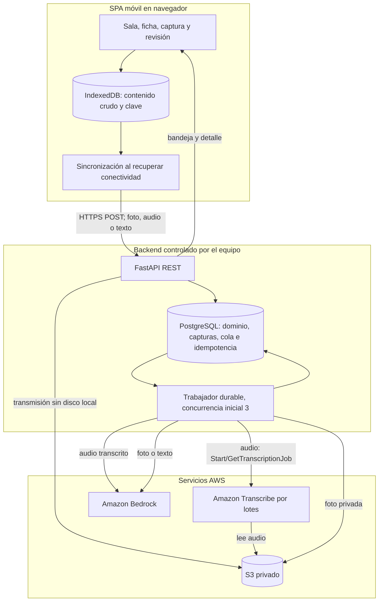
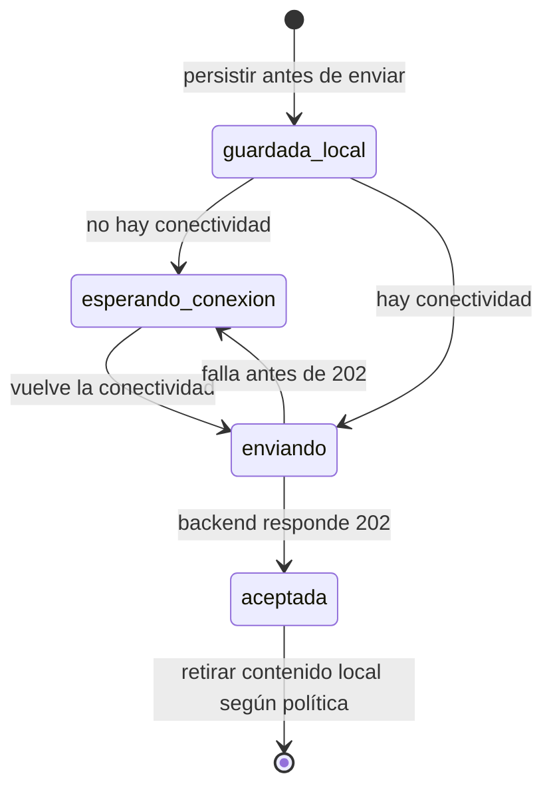
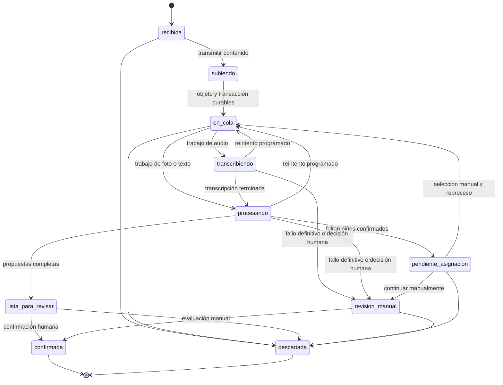
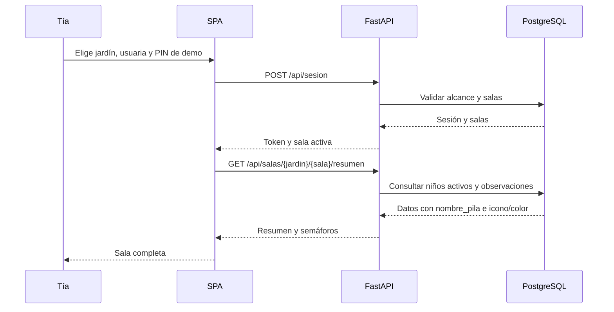
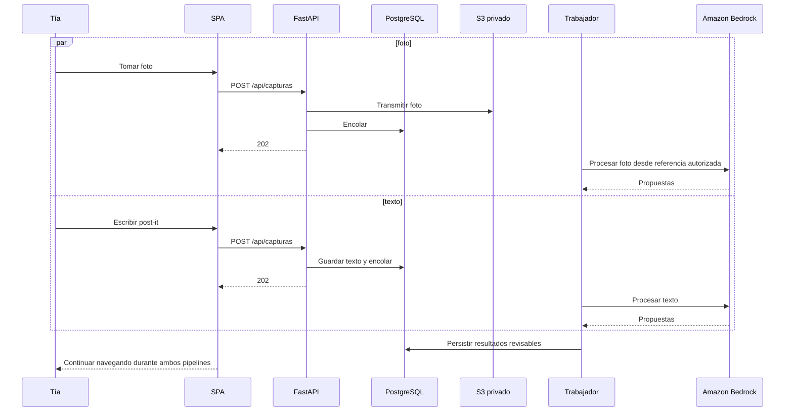
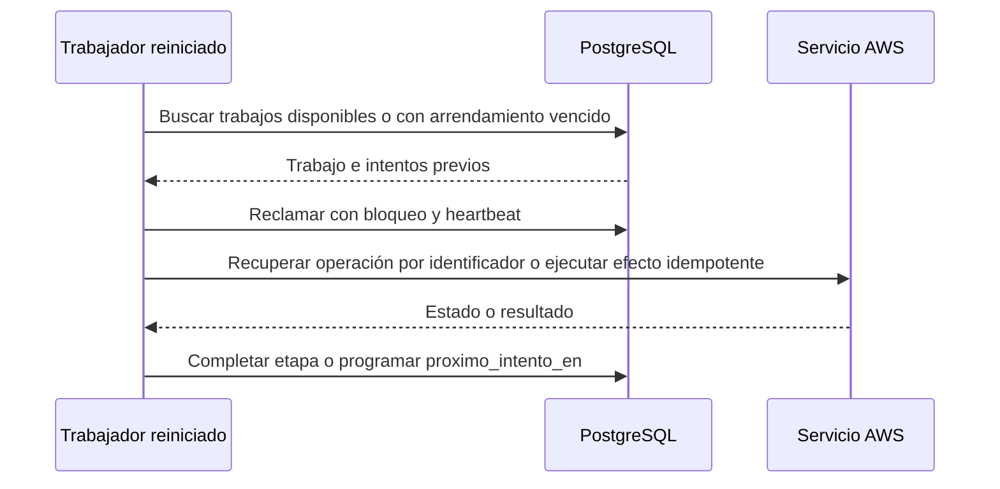

# Documento de Diseño: Plataforma de Observación para Jardines Infantiles

> Proyecto de hackathon sobre el dataset sintético E-1 (jardines, educadoras, niños/as, ruta de nueve niveles, manifestaciones y observaciones). Todos los registros de la demostración son ficticios. La ruta de niveles y las sugerencias de IA son apoyo pedagógico: no son un instrumento clínico, diagnóstico, de tamizaje ni una evaluación validada.

**Notación:** el pseudocódigo usa bloques `pascal`. La implementación existente del repositorio es una demostración ilustrativa y no restringe esta arquitectura objetivo.

## Overview

La plataforma es una web móvil para educadoras y técnicas de párvulos. Permite crear capturas nuevas de **foto, audio y texto/post-it**. El valor `video` se conserva exclusivamente para leer observaciones históricas del dataset; no se graban ni se suben registros nuevos de ese formato. La IA propone candidatos, nivel, manifestaciones y una nota breve, pero la tía siempre revisa y confirma antes de crear una observación.

El flujo es asíncrono y no bloqueante. La aplicación conserva primero cada captura en IndexedDB. Si no hay conectividad, queda en `esperando_conexion`; no se ejecuta IA ni procesamiento local. Cuando vuelve la conexión, la SPA entrega la captura a FastAPI con la misma clave de idempotencia. El backend la guarda de forma durable, responde `202 Accepted` sin esperar a Amazon Transcribe ni Amazon Bedrock y la procesa mediante una cola persistente. Mientras tanto, la tía puede navegar, tomar más fotos, escribir textos, grabar otros audios y consultar la bandeja.

Se aplican tres principios:

- **El dataset es la fuente histórica de verdad.** Sus siete tablas, conteos y reglas se conservan. Las entidades operativas se agregan sin alterar los CSV.
- **La IA propone y la tía decide.** Ningún trabajador crea observaciones; la confirmación humana es obligatoria.
- **Backend dueño de AWS.** La SPA solo se comunica con FastAPI. Las credenciales temporales y todas las llamadas a S3, Amazon Transcribe y Amazon Bedrock permanecen en backend.

### Glosario y mapeo con el dataset

| Término | Término del dataset | Notas |
|---|---|---|
| Tía | `educadoras` | 80 personas, 2 a 6 por jardín. |
| Niño/a | `ninos` + `nino_app` | 500 IDs pseudónimos. La UI usa `nombre_pila`, sin apellidos ni RUT, e icono/color para ayudar a distinguir homónimos. |
| Sala | `(ninos.id_jardin, ninos.sala_grupo)` | 80 salas (`SG-A` a `SG-G`), de 1 a 19 niños/as. |
| Núcleo | `dominio` | Cinco valores canónicos: `motor_grueso`, `motor_fino`, `lenguaje_comunicacion`, `socioemocional`, `cognitivo`. |
| Nivel | `ruta_niveles.nivel` | Nueve niveles orientativos, del 1 al 9. |
| Manifestación | `manifestaciones` | 90 registros: 9 niveles × 5 dominios × 2. |
| Observación | `observaciones` + `observacion_manifestaciones` | 2950 observaciones y 8850 vínculos históricos; cada observación pertenece a un niño/a. |
| Captura nueva | Entidades operativas de la app | Contenido crudo de foto, audio o texto antes de confirmación. Puede producir propuestas para varios niños/as. |
| Registro histórico audiovisual | `observaciones.formato_captura = video` | Compatibilidad de lectura, solo en historial/feed autorizado; nunca se acepta como captura nueva. |
| Directora | `usuario_app` | Rol ficticio de la demostración, uno por jardín. |
| `FECHA_HOY` | `fecha_referencia = 2026-10-13` | Configurable; mantiene coherencia con las alertas del dataset. |

### Decisiones y supuestos

| ID | Decisión | Motivo |
|---|---|---|
| D1 | `asignacion_sala` se siembra desde observaciones y luego es editable por directora. | El dataset no relaciona directamente a cada tía con salas. |
| D2 | Se agrega el rol `directora`. | La vista de jardín lo requiere. |
| D3 | “Núcleo” equivale a `dominio`; DIAEP aporta principios de juicio profesional, no otra rúbrica. | Evita mezclar rangos etarios. |
| D4 | La asistencia es una extensión opcional y sintética. | No existe en el dataset. |
| D5 | La UI muestra nombres de pila sin apellidos ni RUT. No hay reconocimiento facial, de voz ni biometría. La coincidencia textual solo propone candidatos de la sala y siempre exige confirmación. | Minimización y control humano. |
| D6 | Para la demostración, `nino_app.nombre_pila` se siembra de forma determinista con nombres ficticios, procurando unicidad dentro de cada sala, y un rol autorizado puede editarlo. En uso real se admiten homónimos: se distinguen con icono/color y selección manual, sin inventar apellidos. | El dataset no contiene nombres. |
| D7 | Las capturas nuevas son únicamente `foto`, `audio` y `texto`. El formato audiovisual heredado se representa solo al leer historia y su creación devuelve 422. | Separa compatibilidad histórica de capacidad vigente. |
| D8 | La aplicación no opera completamente fuera de línea: solo captura y encola contenido crudo durable en IndexedDB; espera conectividad para cualquier entrega o IA. | Amazon Transcribe y Bedrock requieren red. |
| D9 | FastAPI, PostgreSQL y un trabajador durable forman la arquitectura objetivo. El backend transmite archivos a S3 privado sin depender de disco local. | Permite idempotencia, recuperación y trabajos largos. |
| D10 | Amazon Transcribe por lotes procesa audio y Amazon Bedrock genera sugerencias para audio, foto y texto. | Pipelines especializados y asíncronos. |
| D11 | La concurrencia inicial es configurable, con valor predeterminado de 3 trabajos. La aceptación lógica es única por `Idempotency-Key`; las ejecuciones externas son reintentables con efectos idempotentes. | No se promete una garantía física imposible sobre servicios externos. |
| D12 | El audio admite hasta 300 s por defecto; ninguna configuración puede fijar el máximo por debajo de 240 s. | Permite grabaciones de al menos cuatro minutos. |
| D13 | La transcripción completa no tiene el límite de 280 caracteres. Cada nota/resumen por niño y su fragmento de respaldo sí tienen máximo 280. | Separa fuente completa de resultado pedagógico breve. |
| D14 | La demostración usa dataset, nombres y contenidos ficticios y voces del equipo. El uso real exige evaluación legal y de privacidad, consentimiento y controles apropiados. | El contenido se envía a AWS. |

## Architecture

La SPA React/PWA almacena pendientes en IndexedDB y consume una API REST FastAPI. PostgreSQL conserva datos, capturas, idempotencia y cola. Uno o más trabajadores reclaman trabajos con arrendamiento y límite global configurable. S3 almacena temporalmente objetos privados; Transcribe procesa audio desde S3 y Bedrock procesa transcripciones, fotos y textos. No se requieren Lambda, SAM ni API Gateway, y la arquitectura no queda atada a un proveedor de alojamiento del backend.



La SPA no recibe credenciales AWS, no llama a AWS y no obtiene URLs de escritura. Si una lectura multimedia autorizada es imprescindible, FastAPI emite una URL breve después de comprobar el alcance.

### Ciclo de vida de una captura

**Estado local, solo en IndexedDB:** el registro contiene contenido crudo, metadatos, `Idempotency-Key` y `esperando_conexion`. Sobrevive recargas. Se elimina o marca entregado únicamente tras recibir 202. Un reenvío usa la misma clave.



**Estados persistidos en backend:** `subiendo` es una etapa interna de aceptación. El backend responde 202 solo cuando el objeto necesario y la captura/cola quedaron durables. `demorada` es una condición operacional calculada sobre el estado y la edad del trabajo, no un estado terminal.



Los trabajos estancados permanecen visibles como pendientes/demorados. Pueden reintentarse o pasar a `revision_manual` según un umbral operacional configurable, sin perder la captura ni bloquear a la usuaria.

## Diagramas de secuencia

### Flujo 1: sesión y vista de sala



### Flujo 2: audio asíncrono, reconexión y trabajo continuo

```mermaid
sequenceDiagram
    participant T as Tía
    participant W as SPA
    participant I as IndexedDB
    participant A as FastAPI
    participant D as PostgreSQL
    participant S as S3 privado
    participant Q as Trabajador
    participant R as Amazon Transcribe
    participant B as Amazon Bedrock

    T->>W: Graba audio con MediaRecorder o elige archivo
    W->>W: Fragmentos con timeslice; Wake Lock si está disponible
    W->>I: Guardar crudo, MIME, duración y clave idempotente
    alt sin conectividad
        W-->>T: Mostrar esperando_conexion; permitir seguir trabajando
        Note over W,I: No se ejecuta IA local
        W->>W: Detectar recuperación de conectividad
    end
    W->>A: POST /api/capturas con la misma Idempotency-Key
    A->>S: Transmitir audio sin disco local
    A->>D: Transacción: captura y trabajo en cola
    A-->>W: 202 con id_captura y estado en_cola
    W->>I: Marcar entrega aceptada
    W-->>T: Volver a la app y permitir más capturas

    Q->>D: Reclamar trabajo con arrendamiento; máximo inicial 3
    Q->>R: StartTranscriptionJob sobre objeto S3
    loop consulta inicial cada 5 s, configurable y con backoff
        Q->>R: GetTranscriptionJob
        R-->>Q: IN_PROGRESS o resultado
    end
    Q->>D: Guardar texto completo, palabras, confianza, idioma y modelo
    Q->>B: Solicitar propuestas por niño
    B-->>Q: Nota, evidencia, nivel y manifestaciones
    Q->>D: Guardar sugerencias y lista_para_revisar

    loop bandeja cada 30 s
        W->>A: GET /api/alertas/bandeja
        A-->>W: Capturas en curso, demoradas y revisables
    end
    W-->>T: Aviso interno de finalización
    T->>W: Abrir detalle cuando quiera
    W->>A: GET /api/capturas/{id}
    A-->>W: Progreso, transcripción y sugerencias autorizadas
    T->>W: Corregir, aceptar o reemplazar
    W->>A: POST /api/capturas/{id}/confirmar
    A->>D: Crear observaciones en transacción
    A-->>W: IDs creados
```

### Flujo 3: foto y texto en pipelines coexistentes



### Flujo 4: recuperación del trabajador



## Components and Interfaces

### Componente 1: sesión y shell

`ServicioSesion` autentica, fija el jardín y limita a la tía a sus salas. El PIN fijo es solo de demostración.

```pascal
STRUCTURE Sesion
  token: String
  rol: ENUM(educadora, directora)
  id_jardin: String
  id_educadora: String OR NULL
  salas_asignadas: Lista<String>
  sala_activa: String OR NULL
  expira_en: Timestamp
END STRUCTURE
```

### Componente 2: vista de sala

```pascal
STRUCTURE NinoResumen
  id_nino: String
  nombre_pila: String
  icono_desambiguacion: String
  color_desambiguacion: String
  edad_meses: Integer
  nivel_actual: Integer OR NULL
  semaforo: EstadoSemaforo
  dias_sin_observar: Integer OR NULL
  total_observaciones: Integer
  insignias: Lista<Insignia>
END STRUCTURE
```

Icono y color son ayudas visuales estables, no identidad, biometría ni sustituto de selección manual. Los homónimos son válidos.

### Componente 3: captura de foto, audio y texto

```pascal
INTERFACE ServicioCaptura
  crearCaptura(token, formato, contenido, metadatos, clave_idempotencia): AceptacionCaptura
  obtenerCaptura(token, id_captura): CapturaDetalle
  corregirNinos(token, id_captura, ids_nino): CapturaDetalle
  corregirTranscripcion(token, id_captura, texto_completo): CapturaDetalle
  confirmarCaptura(token, id_captura, items): Lista<String>
  descartarCaptura(token, id_captura): VOID
END INTERFACE

STRUCTURE AceptacionCaptura
  codigo_http: Integer
  id_captura: String
  estado: CapturaEstado
END STRUCTURE

STRUCTURE ItemConfirmacion
  id_nino: String
  nivel_estimado: Integer
  ids_manifestacion: Lista<String>
  nota_breve: String
END STRUCTURE
```

- Formatos de creación: `foto`, `audio`, `texto`.
- Audio: máximo predeterminado 300 s; el administrador puede aumentarlo, pero nunca reducirlo por debajo de 240 s.
- MediaRecorder negocia WebM, Ogg, MP4 o M4A según el navegador, usa `timeslice` para producir fragmentos y solicita Wake Lock cuando esté disponible. La falta de Wake Lock no cancela la grabación. Hay selector de archivo alternativo al micrófono.
- La SPA persiste crudo y clave en IndexedDB antes de intentar la red. No contiene clientes ni claves AWS.

### Componente 4: servicios de IA en backend

```pascal
INTERFACE ServicioTranscripcion
  iniciar(id_captura, clave_s3, idioma): id_trabajo
  consultar(id_trabajo): EstadoTranscripcion
END INTERFACE

INTERFACE ServicioBedrock
  sugerirDesdeTexto(texto, roster, catalogo): Lista<SugerenciaIA>
  sugerirDesdeFoto(clave_s3, roster, catalogo): Lista<SugerenciaIA>
END INTERFACE

STRUCTURE PalabraTranscrita
  texto: String
  inicio_segundos: Real OR NULL
  fin_segundos: Real OR NULL
  confianza: Real
  dudosa: Boolean
END STRUCTURE

STRUCTURE TextoTranscrito
  texto_completo: String
  palabras: Lista<PalabraTranscrita>
  confianza_agregada: Real OR NULL
  idioma: ENUM(es-US, es-MX, es-ES)
  proveedor: String
  modelo: String
  id_trabajo: String
  iniciado_en: Timestamp
  terminado_en: Timestamp OR NULL
END STRUCTURE

STRUCTURE CandidatoNino
  id_nino: String
  confianza_asignacion: Real
  origen: ENUM(nombre_exacto, nombre_aproximado, seleccion_manual)
END STRUCTURE

STRUCTURE SugerenciaIA
  id_nino: String
  nivel_sugerido: Integer
  ids_manifestacion_sugeridas: Lista<String>
  nota_sugerida: String
  fragmento_respaldo: String
  certeza: Real
  banda_certeza: ENUM(alta, media, baja)
  proveedor: String
  modelo: String
END STRUCTURE
```

El texto completo no se trunca a 280 caracteres. `nota_sugerida` y `fragmento_respaldo` tienen máximo 280 cada uno, y el fragmento debe provenir de la transcripción o texto fuente. El idioma se elegirá después de medir `es-US`, `es-MX` y `es-ES` con voces chilenas; no existe `es-CL` en este servicio.

### Componente 5: ficha, historial y guía

La ficha conserva historial, progreso anual, cinco carriles por núcleo, guía de diez manifestaciones del nivel y recomendación de cinco áreas. Un registro histórico con formato `video` se muestra como solo lectura y con la insignia “registro histórico”.

### Componente 6: vista de directora

Resume salas, actividad de educadoras y alertas del jardín. Solo un rol autorizado edita `nombre_pila`, traslada o da de baja.

### Componente 7: alertas y bandeja

```pascal
STRUCTURE Bandeja
  capturas_pendientes: Lista<CapturaResumen>
  ninos_por_revisar: Lista<NinoResumen>
  contador_total: Integer
END STRUCTURE
```

Incluye `recibida`, `subiendo`, `en_cola`, `transcribiendo`, `procesando`, `lista_para_revisar`, `pendiente_asignacion`, `revision_manual` y condición `demorada`. El aviso interno se detecta por polling cada 30 s; una notificación del navegador es opcional y requiere consentimiento.

### Componente 8: sistema visual y privacidad

Los componentes compartidos muestran nombre de pila, icono y color; nunca apellidos ni RUT. El aviso previo explica que foto, audio y texto se envían a AWS. Las miniaturas se ocultan o difuminan hasta una acción autorizada. El historial audiovisual heredado tiene controles de solo lectura.

### Componente 9: sincronización cliente

`ServicioSincronizacion` persiste antes de enviar, escucha recuperación de conectividad, reusa la misma clave y retira el pendiente solo tras 202. Si IndexedDB no está disponible o no tiene cuota, informa que aún no puede prometer guardado y no descarta silenciosamente contenido. No ejecuta IA.

### Componente 10: trabajador durable

Reclama filas con bloqueo, arrendamiento y heartbeat; respeta máximo 3 trabajos activos por defecto; registra intentos, `proximo_intento_en`, error sanitizado, proveedor, modelo y IDs externos. Tras reinicio retoma trabajos vencidos. Audio, foto y texto pueden procesarse a la vez.

## Data Models

### Esquema relacional

Las siete primeras entidades corresponden al dataset histórico sin cambios; las demás son extensiones.

```mermaid
erDiagram
    JARDINES ||--o{ EDUCADORAS : emplea
    JARDINES ||--o{ NINOS : atiende
    NINOS ||--o{ OBSERVACIONES : tiene
    EDUCADORAS ||--o{ OBSERVACIONES : registra
    OBSERVACIONES ||--o{ OBSERVACION_MANIFESTACIONES : evidencia
    MANIFESTACIONES ||--o{ OBSERVACION_MANIFESTACIONES : respalda
    RUTA_NIVELES ||--o{ MANIFESTACIONES : define
    NINOS ||--|| NINO_APP : extiende
    EDUCADORAS ||--o{ CAPTURA : crea
    CAPTURA ||--o| CAPTURA_TRANSCRIPCION : contiene
    CAPTURA_TRANSCRIPCION ||--o{ TRANSCRIPCION_ITEM : desglosa
    CAPTURA ||--o{ COLA_PROCESAMIENTO : procesa
    CAPTURA ||--o{ SUGERENCIA_IA : genera
    CAPTURA ||--o{ OBSERVACION_META : origina
    OBSERVACIONES ||--o| OBSERVACION_META : describe

    JARDINES {
        string id_jardin PK
        string nombre_fantasia
        string comuna
        string region
        int numero_salas
        int numero_educadoras
    }
    EDUCADORAS {
        string id_educadora PK
        string id_jardin FK
        string rol
        int anios_experiencia
    }
    NINOS {
        string id_nino PK
        date fecha_nacimiento
        string sexo_registrado
        string id_jardin FK
        string sala_grupo
        date fecha_ingreso
    }
    RUTA_NIVELES {
        int nivel PK
        string nombre_nivel
        int edad_min_meses
        int edad_max_meses
        string dominios
        string descripcion
    }
    MANIFESTACIONES {
        string id_manifestacion PK
        int nivel FK
        string dominio
        string texto_observable
    }
    OBSERVACIONES {
        string id_observacion PK
        string id_nino FK
        string id_educadora FK
        date fecha_observacion
        string formato_captura
        int nivel_estimado
        string nota_breve
    }
    OBSERVACION_MANIFESTACIONES {
        string id_observacion PK
        string id_manifestacion PK
    }
    NINO_APP {
        string id_nino PK
        string nombre_pila
        string icono_desambiguacion
        string color_desambiguacion
        string estado
        string id_jardin_actual
        string sala_grupo_actual
    }
    CAPTURA {
        string id_captura PK
        string id_jardin
        string sala_grupo
        string id_educadora FK
        string formato
        string mime
        int tamano_bytes
        int duracion_segundos
        string clave_s3_opaca
        string texto_fuente
        string estado
        string clave_idempotencia
        timestamp creado_en
        timestamp actualizado_en
        string error_operativo
    }
    CAPTURA_TRANSCRIPCION {
        string id_transcripcion PK
        string id_captura FK
        string texto_completo
        string idioma
        string proveedor
        string modelo
        string id_trabajo
        float confianza_agregada
        timestamp iniciado_en
        timestamp terminado_en
        timestamp corregido_en
        string corregido_por
    }
    TRANSCRIPCION_ITEM {
        string id_item PK
        string id_transcripcion FK
        string texto
        float inicio_segundos
        float fin_segundos
        float confianza
    }
    COLA_PROCESAMIENTO {
        string id_trabajo PK
        string id_captura FK
        string pipeline
        string etapa
        string estado
        int intentos
        timestamp proximo_intento_en
        string propietario_arrendamiento
        timestamp arrendamiento_hasta
        timestamp heartbeat_en
        string id_externo
        string error
        timestamp creado_en
        timestamp actualizado_en
    }
    SUGERENCIA_IA {
        string id_captura PK
        string id_nino PK
        int nivel_sugerido
        string ids_manifestacion_sugeridas
        string nota_sugerida
        string fragmento_respaldo
        float certeza
        string proveedor
        string modelo
    }
    OBSERVACION_META {
        string id_observacion PK
        string id_captura FK
        string origen_evaluacion
        float certeza_ia
        int nivel_sugerido_ia
        timestamp creado_en
    }
```



Además permanecen `usuario_app`, `asignacion_sala`, `traslado_nino` y `asistencia` con las relaciones y auditoría descritas en el diseño original.

### Reglas heredadas del dataset

Estas reglas describen datos existentes y **no autorizan formatos nuevos**:

- `observaciones.formato_captura` admite históricamente `video|audio|texto|foto`. El valor `video` se conserva únicamente para lectura compatible de historial/feed.
- `nivel_estimado` es entero de 1 a 9. Cada observación se vincula con 1 a 5 manifestaciones únicas del nivel exacto.
- `nota_breve` tiene máximo 280 caracteres; vacía significa que no se añadió nota.
- `fecha_ingreso` es anterior o igual a la primera observación. La edad usa meses completos.
- Educadora y niño/a de una observación pertenecen al mismo jardín; se cumple en las 2950 observaciones.
- “Sin registro” nunca significa “no logrado”.
- El primer ID nuevo de observación es `OBS-0002951`.
- La siembra conserva 20 jardines, 80 educadoras, 500 niños/as, 9 niveles, 90 manifestaciones, 2950 observaciones y 8850 vínculos.

### Reglas de nuevas capturas

- `POST /api/capturas` acepta solo `foto|audio|texto`; un intento de crear `video` devuelve 422.
- El máximo de audio es 300 s por defecto y la configuración debe ser siempre mayor o igual a 240 s. MIME y tamaño se validan mediante listas configurables.
- Un 202 implica que contenido, captura, idempotencia y trabajo requerido quedaron durables. No implica IA terminada.
- `clave_idempotencia` es única en el alcance de la usuaria; reenvíos devuelven el mismo `id_captura`.
- Los estados backend son los del ciclo de vida; `esperando_conexion` nunca se persiste como estado de servidor.
- La transcripción completa no tiene límite de 280 caracteres. Nota y fragmento por niño tienen máximo 280 cada uno.
- Cada palabra conserva confianza; una confianza menor a 0,60 queda marcada como dudosa. El umbral es configurable.
- Se persisten idioma, proveedor, modelo, identificador externo y tiempos.
- Los idiomas candidatos son `es-US`, `es-MX` y `es-ES`; la selección queda pendiente del benchmark chileno.
- Solo `confirmarCaptura` puede insertar observaciones.

### Extensiones operativas

La siembra de `nombre_pila` usa una lista fija de nombres ficticios y una función determinista del ID. Procura unicidad dentro de la sala solo para la demo. No existe restricción de unicidad en producción. Un rol autorizado puede editar el nombre. Cuando hay homónimos, la UI muestra icono/color estable y exige selección manual.

La cola usa bloqueos y arrendamientos recuperables. La restricción única por captura, pipeline y etapa evita efectos internos duplicados; las llamadas externas guardan sus identificadores para recuperar estado. Se conserva contenido completo durante procesamiento y revisión. Por defecto se purgan audio y transcripciones en hasta 24 h después de un estado terminal, salvo necesidad explícita autorizada. Las fotos crudas usan una política breve equivalente y configurable. La observación confirmada conserva `nota_breve` y el fragmento mínimo autorizado para trazabilidad.

## Pseudocódigo algorítmico

### Algoritmo 1: edad y niveles compatibles

`edadEnMeses` mantiene la fórmula histórica `12*(año_obs-año_nac)+(mes_obs-mes_nac)-1[día_obs<día_nac]`. `nivelesCompatibles` devuelve los niveles cuyo rango inclusivo contiene la edad y usa 9 para edades superiores al alcance. Se conserva su pureza y equivalencia con `consolidado.json`.

### Algoritmo 2: semáforo

Sin observaciones devuelve `SIN_EVALUAR`. Con observaciones, ordena por fecha e ID y devuelve `VERDE`, `AMARILLO` o `ROJO` según umbrales configurables. Las insignias `FUERA_DE_RANGO`, `BAJA_DE_NIVEL`, `INGRESO_RECIENTE` y `AREA_SIN_EVIDENCIA` nunca cambian el color ni usan lenguaje diagnóstico.

### Algoritmo 3: aceptación, sincronización y trabajo

```pascal
ALGORITHM sincronizarPendiente(pendiente)
BEGIN
  ASSERT pendiente ya está durable en IndexedDB
  WHILE no haya conectividad DO
    marcarLocal(pendiente, esperando_conexion)
    esperarCambioDeRed()
  END WHILE
  respuesta ← POST captura con pendiente.clave_idempotencia
  IF respuesta.codigo = 202 THEN marcarLocalComoAceptada(pendiente) END IF
  // Ante fallo se conserva y se reenvía con la misma clave; no se ejecuta IA local.
END

ALGORITHM aceptarCaptura(sesion, formato, flujo, metadatos, clave)
BEGIN
  IF formato NOT IN (foto, audio, texto) THEN RETURN HTTP 422 END IF
  validarMimeTamanoYDuracion(formato, metadatos)
  existente ← buscarPorClave(sesion.id_usuario, clave)
  IF existente IS NOT NULO THEN RETURN HTTP 202 existente.id END IF
  INICIAR TRANSACCIÓN
    IF formato IN (foto, audio) THEN
      clave_s3 ← transmitirAS3Privado(flujo)  // sin disco local
    END IF
    captura ← insertarCaptura(recibida, clave_s3, clave)
    insertarTrabajo(captura.id, en_cola, intentos = 0)
  CONFIRMAR TRANSACCIÓN
  RETURN HTTP 202 captura.id
END

ALGORITHM reclamarTrabajo(trabajador)
BEGIN
  trabajo ← seleccionarDisponibleConBloqueo(
    proximo_intento_en <= ahora(), arrendamiento vencido, limite_activo_configurado)
  IF trabajosActivos() >= limite_configurado_por_defecto_3 THEN RETURN NULO END IF
  asignarArrendamientoYHeartbeat(trabajo, trabajador)
  RETURN trabajo
END

ALGORITHM procesarTrabajo(trabajo)
BEGIN
  captura ← leerCaptura(trabajo.id_captura)
  TRY
    IF captura.formato = audio THEN
      id_externo ← recuperarOIniciarStartTranscriptionJob(captura.clave_s3, idioma_configurado)
      REPETIR con espera inicial de 5 s configurable y backoff
        resultado ← GetTranscriptionJob(id_externo)
      HASTA resultado sea terminal
      guardarTranscripcionCompletaYPalabras(resultado)
      texto ← resultado.texto_completo
    ELSE IF captura.formato = foto THEN
      texto ← Bedrock.describirFoto(captura.clave_s3)
    ELSE
      texto ← captura.texto_fuente
    END IF
    candidatos ← asignarNinos(texto, rosterDeSala(captura))
    IF candidatos está vacío o ambiguo THEN
      cambiarEstado(pendiente_asignacion)
    ELSE
      guardarSugerencias(Bedrock.sugerir(texto, candidatos, catalogo))
      cambiarEstado(lista_para_revisar)
    END IF
  CATCH errorTemporal
    incrementarIntentosYProgramarBackoff(trabajo)
    cambiarEstado(en_cola)
  CATCH errorDefinitivo
    cambiarEstado(revision_manual)
  END TRY
END
```

### Algoritmo 4: candidatos por nombre de pila

```pascal
ALGORITHM asignarNinos(texto, roster, preseleccion)
BEGIN
  candidatos ← seleccionesManualesValidas(preseleccion, roster)
  FOR each n IN roster DO
    IF nombreNormalizado(n.nombre_pila) coincide exacta o aproximadamente con texto THEN
      agregarPropuesta(candidatos, n)
    END IF
  END FOR
  agruparHomónimosSinAutoasignar(candidatos)
  RETURN candidatos  // la tía siempre confirma
END
```

Todo candidato pertenece a la sala. Un nombre repetido produce opciones con icono/color y selección manual; nunca se inventa un apellido. No se usan rostro, voz ni otra biometría.

### Algoritmo 5: sugerencia Bedrock

Bedrock recibe el texto fuente y candidatos ya acotados. Devuelve por niño un nivel 1..9, entre 1 y 5 manifestaciones únicas del nivel, certeza, `nota_sugerida` de hasta 280 caracteres y `fragmento_respaldo` de hasta 280 presente en el texto. El resultado conserva modelo/proveedor y siempre queda pendiente de revisión humana.

### Algoritmo 6: corrección y confirmación

```pascal
ALGORITHM corregirTranscripcion(sesion, captura, nuevo_texto)
BEGIN
  autorizarRevision(sesion, captura)
  guardarVersionAuditada(nuevo_texto, sesion.id_usuario, ahora())
  invalidarSugerenciasNoConfirmadas()
  encolarBedrockIdempotente(captura.id, hash(nuevo_texto))
END

ALGORITHM confirmarCaptura(sesion, captura, items)
BEGIN
  ASSERT captura.estado IN (lista_para_revisar, revision_manual)
  autorizarSala(sesion, captura)
  IF captura.estado = confirmada THEN RETURN observacionesExistentes(captura.id) END IF
  INICIAR TRANSACCIÓN
    FOR each item IN items DO
      validarNivelManifestacionesNotaYSala(item)
      insertarObservacionYVinculos(item)
      insertarTrazabilidadDeSugerencia(item)
    END FOR
    cambiarEstado(confirmada)
  CONFIRMAR TRANSACCIÓN
END
```

Una palabra es dudosa si `confianza < umbral_confianza_palabra`, cuyo valor inicial es 0,60. La corrección queda auditada y reprocesa únicamente sugerencias aún no confirmadas.

### Algoritmo 7: recomendador y guía

Para el nivel de referencia calcula cobertura de los cinco núcleos con sus dos manifestaciones, devuelve cinco recomendaciones en orden determinista y muestra las diez manifestaciones como `evidenciada` o `sin_registro`.

### Algoritmo 8: traslado y baja

El traslado exige destino distinto del mismo jardín, conserva todas las observaciones y registra sala origen/destino, motivo, autor y momento. La baja solo la realiza una directora, es lógica, reversible y no borra observaciones.

## Funciones clave con especificaciones formales

| Función | Precondiciones | Postcondiciones |
|---|---|---|
| `resumenSala` | Sesión autorizada | Lista niños activos con `nombre_pila`; conteos suman el total. |
| `sincronizarPendiente` | Crudo y clave persistidos | Sin conectividad no llama IA; tras 202 retira o marca el pendiente. |
| `crearCaptura` | Formato nuevo permitido; MIME, tamaño y duración válidos | Una captura lógica por clave; 202 tras durabilidad, sin esperar inferencia. |
| `reclamarTrabajo` | Cupo y trabajo disponible | Arrendamiento exclusivo; activos no superan el límite configurado. |
| `obtenerCaptura` | Acceso a sala/jardín | Devuelve estado, progreso, condición demorada y resultados autorizados, sin secretos AWS. |
| `consultarTranscripcion` | Captura de audio autorizada | Devuelve texto completo, items, idioma, proveedor/modelo y tiempos. |
| `corregirTranscripcion` | Rol autorizado y captura no confirmada | Guarda auditoría y encola nuevamente Bedrock de forma idempotente. |
| `asignarNinos` | Roster activo de la sala | Candidatos solo de la sala; homónimos requieren selección. |
| `confirmarCaptura` | Estado revisable e items válidos | Operación atómica e idempotente; crea observaciones solo aquí. |
| `recomendarArea` | Niño/a existente | Cinco núcleos, sin repetición y orden determinista. |
| `trasladarNino` | Destino válido del mismo jardín | Auditoría completa y observaciones intactas. |

## Ejemplo de uso

Una tía graba hasta 300 s con fragmentos. IndexedDB conserva la grabación y la clave. Si falta conectividad, la app indica que espera conexión; cuando vuelve, entrega una vez lógicamente y recibe 202. La tía toma otra foto mientras el audio está en Transcribe. La bandeja, consultada cada 30 s, informa cuándo ambos están revisables. Solo entonces abre el detalle y confirma.

```json
{
  "id_captura": "CAP-000012",
  "estado": "lista_para_revisar",
  "transcripcion": {
    "texto_completo": "Sofía balbucea de forma continua durante el juego libre y luego comparte el objeto con Mateo.",
    "idioma": "es-MX",
    "proveedor": "amazon_transcribe",
    "modelo": "batch-standard",
    "id_trabajo": "tr-CAP-000012",
    "palabras": [
      {"texto": "Sofía", "confianza": 0.91, "dudosa": false},
      {"texto": "balbucea", "confianza": 0.58, "dudosa": true}
    ]
  },
  "sugerencias": [
    {
      "id_nino": "NINO-00002",
      "nombre_pila": "Sofía",
      "nivel_sugerido": 4,
      "ids_manifestacion_sugeridas": ["MAN-L04-LC-01", "MAN-L04-LC-02"],
      "nota_sugerida": "Balbucea de forma continua durante el juego libre.",
      "fragmento_respaldo": "Sofía balbucea de forma continua durante el juego libre",
      "certeza": 0.82,
      "proveedor": "amazon_bedrock",
      "modelo": "modelo-habilitado-configurable"
    }
  ]
}
```

Si dos niñas se llaman Sofía, la propuesta muestra ambas con su icono/color y la tía selecciona una; el sistema no decide automáticamente. Foto y texto pueden estar `procesando` en paralelo. Un registro histórico con `formato_captura: "video"` se devuelve 200 como solo lectura, mientras intentar crearlo por POST devuelve 422.

El caso `NINO-00002` conserva sus 6 observaciones con niveles 3, 4, 4, 4, 4 y 5 entre 2025-03-03 y 2025-08-03.

## Correctness Properties

- **P1 Alcance:** toda fila devuelta pertenece al jardín y, para una tía, a una sala autorizada.
- **P2 Resumen:** total de niños activos y suma de semáforos coinciden.
- **P3 Semáforo:** la severidad no disminuye cuando aumentan los días; cero observaciones equivale a `SIN_EVALUAR`.
- **P4 Insignias:** no alteran el color.
- **P5 Candidatos:** pertenecen a la sala; homónimos nunca se autoasignan y toda propuesta requiere confirmación.
- **P6 Sin candidato:** queda `pendiente_asignacion` y visible en bandeja.
- **P7 Forma de sugerencia:** nivel 1..9, 1..5 manifestaciones únicas del nivel, certeza válida, nota y fragmento de máximo 280.
- **P8 Control humano:** antes de `confirmarCaptura` hay cero observaciones creadas por esa captura.
- **P9 Confirmación:** atómica, idempotente y conforme a reglas históricas.
- **P10 Trazabilidad:** toda observación muestra autor y fecha; las nuevas incluyen hora y origen.
- **P11 Ficha:** historial y línea de tiempo representan exactamente observaciones y vínculos.
- **P12 Siembra:** conserva 20/80/500/9/90/2950/8850 y es idempotente.
- **P13 Traslado/baja:** conservan observaciones y auditoría.
- **P14 Recomendador:** devuelve cinco núcleos sin repetir y en orden determinista.
- **P15 Privacidad:** no aparecen apellidos ni RUT; no hay biometría y el multimedia no cruza alcances autorizados.
- **P16 Edad:** las 2950 edades coinciden con `consolidado.json`.
- **P17 Compatibilidad:** toda lectura histórica autorizada representa `video`; toda creación nueva de ese formato devuelve 422.
- **P18 Espera de conectividad:** sin conectividad no hay llamadas de IA, y contenido/clave sobreviven recarga.
- **P19 Idempotencia:** reenvíos concurrentes de una clave producen una sola captura lógica.
- **P20 Recuperación:** ningún trabajo durable se pierde tras reinicio; con configuración inicial no hay más de 3 activos.
- **P21 Frontera AWS:** todas las llamadas a S3, Transcribe y Bedrock parten del backend.
- **P22 Aceptación:** 202 no espera Transcribe ni Bedrock.
- **P23 Longitudes:** el texto completo puede superar 280; toda nota y fragmento respetan 280.
- **P24 Confianza:** toda palabra por debajo del umbral configurable aparece marcada.
- **P25 Trazabilidad IA:** idioma, proveedor, modelo, identificadores y tiempos quedan persistidos.
- **P26 Retención:** las purgas se ejecutan dentro de la política configurada y conservan solo evidencia mínima autorizada.
- **P27 Ejecución externa:** puede haber más de un intento físico, pero los manejadores y efectos internos son idempotentes.

## Error Handling

| Escenario | Respuesta visible/HTTP | Estado y recuperación |
|---|---|---|
| Cámara o micrófono denegado | Ofrecer selector de foto/audio o texto | No se crea pendiente hasta elegir contenido. |
| Contexto no seguro | Explicar requisito HTTPS | Selector de archivo sigue disponible. |
| IndexedDB sin cuota o no disponible | Avisar que el guardado durable no está garantizado | No descartar ni afirmar que quedó encolado. |
| Sin conectividad antes de 202 | Mostrar `esperando_conexion` | Conservar crudo y reusar clave al volver la red; sin IA. |
| Carga interrumpida antes de 202 | No mostrar como aceptada | Reenviar la misma clave; backend limpia cargas incompletas. |
| Formato de creación no permitido | 422 | Mantener lectura histórica separada. |
| MIME/duración inválidos | 415 o 422; tamaño excesivo 413 | Elegir archivo compatible o ajustar captura. |
| Credenciales AWS expiradas o permiso ausente | Pendiente/demorada, error genérico | Renovar credenciales; trabajador reintenta con backoff. |
| S3, Transcribe o Bedrock temporalmente indisponible/throttled | 429/503 interno sanitizado; UI muestra pendiente | `proximo_intento_en`, misma operación idempotente. |
| Job Transcribe fallido | Ofrecer `revision_manual` | Conservar audio hasta resolución/retención; permitir texto manual. |
| Trabajo supera umbral de estancamiento | Insignia “demorada” | Reintento o revisión manual; el umbral es operacional, no promesa de latencia. |
| Reinicio de API o trabajador | Sin pérdida visible | Reclamación de arrendamientos vencidos desde PostgreSQL. |
| Límite de concurrencia alcanzado | `en_cola` | Espera justa; no bloquea nuevas aceptaciones dentro de cuotas. |
| Ningún niño o homónimo | `pendiente_asignacion` | Selección manual dentro de la sala. |
| Palabra dudosa | Resaltado bajo 0,60 inicial | Corrección auditada y reproceso opcional. |
| Confirmación inválida | 422 por campo | Corregir nivel, manifestaciones o nota. |
| Acceso fuera de alcance | 403 sin revelar existencia | Sin recuperación automática. |
| Sesión vencida | 401 | Reautenticar; IndexedDB conserva pendientes no aceptados. |

## Testing Strategy

### Unitarias y propiedades

- Edad, niveles, semáforo, recomendador, validación y conteos históricos P2–P4, P7, P9, P12–P16.
- Asignación por `nombre_pila`: coincidencia limitada a sala, homónimos, icono/color y confirmación P5–P6.
- MediaRecorder por WebM/Ogg/MP4/M4A disponibles, `timeslice`, máximo 300 s, rechazo de configuración menor a 240 s, Wake Lock presente/ausente y selector de archivo.
- IndexedDB: persistencia antes de red, recarga, `esperando_conexion`, recuperación y misma clave P18–P19.
- API: 422 al crear `video`, lectura histórica autorizada, idempotencia concurrente, transiciones, 202 durable, autorización de detalle/corrección y separación texto completo/nota P17, P19, P22–P24.
- Hypothesis verifica propiedades universales; fast-check puede cubrir utilidades cliente.

### Integración del trabajador y AWS

Con servicios simulados se prueba transmisión a S3 sin disco, bucket privado, `StartTranscriptionJob`, `GetTranscriptionJob`, consulta inicial cada 5 s configurable, backoff, Bedrock para audio/foto/texto, fallos, reinicio, arrendamiento vencido, heartbeat y máximo 3 activos P20–P21, P25, P27. Se prueba purga predeterminada en hasta 24 h P26.

En la cuenta del hackathon, antes de procesar contenido, una prueba controlada verifica permisos efectivos de S3, Transcribe, Bedrock e IAM con credenciales temporales. No presupone capacidad para administrar AWS Organizations.

### Benchmark de idioma

Con voces del equipo, nombres/contenido ficticios y frases chilenas se ejecutan `es-US`, `es-MX` y `es-ES`. Se registran WER, calidad de términos pedagógicos y propuestas de nombres. El idioma final se configura solo después de medir; no se fija una meta de precisión previa. Se prueba opcionalmente vocabulario con nombres ficticios solo en demo. Producción rechaza vocabularios persistentes con nombres y permite únicamente términos pedagógicos no sensibles.

### E2E, accesibilidad y privacidad

- Login, sala, audio largo aceptado, otra foto y texto durante procesamiento, bandeja/no bloqueo, corrección, confirmación y feed.
- Pérdida de conectividad, recarga, reconexión, un solo ID lógico y recuperación tras reinicio.
- Texto completo mayor de 280, palabras a ambos lados de 0,60, nota/fragmento de 280 y corrección auditada.
- Lectura histórica audiovisual heredada y rechazo de nueva creación.
- Aviso explícito AWS, ausencia de credenciales cliente, autorización de URLs breves, purga y auditoría.
- Siembra completa y caso `NINO-00002` con seis observaciones.
- Golden set con nombres ficticios y términos pedagógicos, sin reutilizar texto del catálogo.
- Tres personas ajenas al equipo validan teléfono/computador, navegación no bloqueante y mensajes neutros.

Cada P1–P27 queda cubierta por al menos una prueba unitaria, de propiedad, integración o E2E.

## Consideraciones de rendimiento

- PostgreSQL indexa observaciones por niño/fecha, niños por jardín/sala, captura por usuaria/clave y cola por estado/`proximo_intento_en`.
- Se mide por separado el tiempo de carga/aceptación; 202 no incluye latencia de Transcribe/Bedrock ni promete resultado inmediato.
- Concurrencia de trabajador: 3 por defecto, configurable según cuotas.
- Consulta de Transcribe: referencia inicial cada 5 s, configurable, con backoff. Bandeja: cada 30 s. Detalle: solo al abrirlo.
- Métricas: profundidad y edad de cola, latencia por etapa, intentos, throttling, fallos, trabajos estancados y tasa de purga.
- El umbral de estancamiento se define después de medir y nunca se presenta como garantía de finalización. La UI sigue habilitada mientras existen trabajos activos.

## Consideraciones de seguridad y privacidad

- **Minimización:** nombre de pila sin apellido ni RUT; icono/color para homónimos; sin reconocimiento facial, vocal ni biométrico.
- **Aviso:** antes de capturar, se informa que foto, audio y texto se enviarán a AWS. La demo usa dataset, nombres/contenido ficticios y voces del equipo.
- **Uso real:** exige evaluación legal y de privacidad, base de consentimiento y controles apropiados. Amazon Transcribe puede almacenar contenido temporalmente según las condiciones aplicables de AWS.
- **Limitación de cuenta:** no se asume permiso para crear una política de AWS Organizations que cambie el uso/mejora del servicio. Primero se verifican S3, Transcribe, Bedrock e IAM.
- **Frontera:** FastAPI conserva credenciales temporales y realiza todas las llamadas AWS. La SPA no recibe claves, roles ni URLs de escritura.
- **S3:** bucket privado, bloqueo de acceso público, cifrado en reposo, mínimo privilegio y claves opacas. Las URLs de lectura son breves, autorizadas y emitidas solo por backend.
- **Retención:** audio y transcripción se borran por defecto en hasta 24 h tras terminar; fotos crudas siguen una política breve equivalente. Toda excepción requiere finalidad y autorización explícitas.
- **Vocabulario:** no se guardan nombres reales en vocabularios personalizados persistentes. Nombres ficticios solo se prueban en demo; producción limita vocabulario a términos pedagógicos no sensibles y resuelve dudas manualmente.
- **Autenticación:** el PIN de demo no es apto para producción; el uso real requiere autenticación robusta, expiración y auditoría.
- **Autorización:** cada endpoint filtra jardín/sala/rol; correcciones, lecturas multimedia y edición de nombres se auditan.
- **Lenguaje:** mensajes neutros; la IA no diagnostica ni reemplaza juicio profesional.

## Dependencias

- **Datos:** siete CSV históricos y `consolidado.json` para equivalencia.
- **Backend:** Python, FastAPI, Pydantic, servidor ASGI, PostgreSQL, controlador SQL, migraciones, SDK AWS/boto3 y trabajador durable.
- **AWS:** región, bucket S3 privado y cifrado, Amazon Transcribe por lotes, modelo Amazon Bedrock habilitado y credenciales temporales. Primer prerrequisito: verificar permisos S3, Transcribe, Bedrock e IAM.
- **Frontend:** React, TypeScript, PWA, IndexedDB, MediaRecorder, Wake Lock opcional y cliente OpenAPI.
- **Pruebas:** pytest, Hypothesis, Vitest/Testing Library y Playwright, si ya forman parte del proyecto.
- **Configuración:** máximo de audio 300 s y mínimo permitido 240 s, concurrencia 3, polling Transcribe 5 s, bandeja 30 s, confianza 0,60, retención hasta 24 h e idioma candidato medido.

## Trazabilidad de las 10 características

| # | Característica | Componentes | Contratos | Propiedades | Dueño |
|---|---|---|---|---|---|
| 1 | Vista/resumen de sala | Vista de sala | resumen | P1–P4 | Basti/Lucas |
| 2 | Colores y alertas | Sala/bandeja | bandeja | P3–P4 | Basti |
| 3 | Captura foto/audio/texto | Captura/sincronización | POST capturas | P17–P19, P22 | Flo/Agustín |
| 4 | Ficha individual | Ficha | ficha/línea/guía | P11, P14 | Cris/Lucas |
| 5 | Vista directora | Directora | salas/educadoras | P1 | Lucas/Basti |
| 6 | Trazabilidad/colaboración | Feed | actividad | P10, P25 | Flo/Lucas |
| 7 | Propuestas por niño | Trabajador/IA | detalle/correcciones | P5–P8, P23–P25 | Agustín |
| 8 | Pendientes | Bandeja | alertas | P6, P20 | Basti |
| 9 | Sesión y alcance | Shell/API | sesión | P1, P15 | Cris/Lucas |
| 10 | Simplicidad/privacidad | Sistema visual | transversal | P15, P18, P21 | Flo/equipo |

La reproducción de `video` pertenece a compatibilidad histórica y no a la característica de captura.

## Plan de trabajo del equipo

### Justificación del stack

| Capa | Elección | Razón |
|---|---|---|
| SPA | React/PWA + IndexedDB | Captura durable y reanudación con experiencia móvil. |
| API | FastAPI | Contrato OpenAPI y control central de autorización/AWS. |
| Datos | PostgreSQL | Cola, bloqueos, idempotencia y recuperación tras reinicios. |
| Archivos | S3 privado | Ingesta por streaming y almacenamiento temporal cifrado. |
| Procesamiento | Trabajador + Transcribe + Bedrock | Pipelines asíncronos coexistentes y trazables. |
| Pruebas | pytest/Hypothesis/Vitest/Playwright | Cobertura de propiedades y E2E. |

### Mapa y fichas por persona

| Persona | Responsabilidad principal | Entregables medibles |
|---|---|---|
| Lucas | PostgreSQL, dominio, seguridad y contrato | Siembra 20/80/500/9/90/2950/8850; OpenAPI; cola/esquema; permisos y autorización. |
| Agustín | Trabajador y adaptadores AWS | S3 sin disco, Transcribe/Bedrock, idempotencia, máximo 3, observabilidad y benchmark de idioma. |
| Flo | Captura y experiencia | Foto/audio/texto; timeslice, Wake Lock, selector, aviso AWS y navegación no bloqueante. |
| Cris | Shell, IndexedDB, sesión y ficha | Persistencia/reanudación, nombres de pila, ficha y caso `NINO-00002`. |
| Basti | Sala, bandeja y notificaciones | Estados en curso/demorados/revisables, polling 30 s, semáforo y panel. |

**Lucas:** entrega esquema PostgreSQL, idempotencia, OpenAPI, seguridad S3/IAM, resumen, ficha y directora. Recibe de Agustín estados externos y de Flo/Cris necesidades de cliente.

**Agustín:** entrega aceptación backend, trabajador recuperable, adaptadores S3/Transcribe/Bedrock, corrección y métricas. Valida idiomas con voces ficticias del equipo. No crea observaciones desde el trabajador.

**Flo:** entrega captura en máximo tres interacciones para foto/texto, grabación de hasta 300 s, selector alternativo, progreso local y aviso de envío. Puede iniciar otra captura mientras una procesa.

**Cris:** entrega shell, sesión, IndexedDB durable, recuperación de red y UI con `nombre_pila`, icono/color y selección de homónimos. La ficha conserva el caso histórico requerido.

**Basti:** entrega bandeja con todos los estados relevantes, condición demorada, aviso interno y notificación opcional consentida; integra semáforo y panel de educadoras.

### Contrato de datos compartido

Los tipos compartidos incluyen `NinoResumen`, `CapturaEstado`, `CapturaTranscripcion`, `PalabraTranscrita`, `TrabajoProcesamiento`, `SugerenciaIA`, `Bandeja` y `Sesion`. OpenAPI usa snake_case y documenta qué campos pueden omitirse mientras el trabajo sigue.

### Endpoints v0

| Método/ruta | Contrato |
|---|---|
| `POST /api/sesion`, `GET /api/sesion`, `PUT /api/sesion/sala` | Sesión y sala activa. |
| `GET /api/salas/{jardin}/{sala}/resumen` | Nombres de pila, semáforo y conteos autorizados. |
| `GET /api/salas/{jardin}/{sala}/actividad` | Feed; representa formatos históricos como solo lectura. |
| `GET /api/ninos/{id}/ficha`, `/linea_tiempo`, `/guia_nivel`, `/recomendacion_area` | Ficha e historia autorizadas. |
| `POST /api/capturas` | Multipart para foto/audio o JSON para texto; exige `Idempotency-Key`; responde 202 durable; creación audiovisual heredada devuelve 422. |
| `GET /api/capturas/{id}` | Estado, progreso, demorada, transcripción y sugerencias según rol. |
| `PUT /api/capturas/{id}/transcripcion` | Corrección auditada y reproceso idempotente antes de confirmar. |
| `PUT /api/capturas/{id}/ninos` | Selección/corrección manual dentro de la sala. |
| `POST /api/capturas/{id}/confirmar` | Único contrato que crea observaciones. |
| `POST /api/capturas/{id}/descartar` | Estado terminal y posterior retención. |
| `GET /api/alertas/bandeja?ambito=` | En curso, demoradas y revisables. |
| `GET /api/directora/jardin/{id}/salas`, `/educadoras` | Vista autorizada del jardín. |

Códigos comunes: 401, 403, 409, 413, 415, 422, 429 y 503. Los errores no filtran bucket, claves ni detalles AWS. La lectura histórica audiovisual usa endpoints de ficha/feed y nunca `POST /api/capturas`.

### Límites conceptuales de carpetas

| Área | Contenido | Dueño |
|---|---|---|
| `api/datos/` | PostgreSQL, siembra, migraciones, repositorios | Lucas |
| `api/dominio/` | Edad, semáforo, catálogo, confirmación | Lucas |
| `api/capturas/` | Contrato, streaming y autorización | Agustín |
| `api/trabajador/` | Cola, arrendamientos, reintentos | Agustín |
| `api/aws/` | S3, Transcribe y Bedrock | Agustín |
| `web/almacenamiento/` | IndexedDB y sincronización | Cris |
| `web/captura/` | Foto, audio, texto y aviso | Flo |
| `web/sala/`, `web/alertas/` | Sala y bandeja | Basti |
| `web/ficha/`, `web/sesion/` | Ficha, shell y sesión | Cris |
| `shared/ui/`, `shared/api/` | Componentes y contrato generado | Flo/Lucas |

### Reglas visuales compartidas

- Nombre de pila como etiqueta principal; ID solo en detalle técnico.
- Homónimos con icono/color y selección manual.
- Semáforo siempre con color, icono y texto.
- Botón global de captura para foto, audio y texto/post-it.
- Registro histórico audiovisual con insignia y controles de solo lectura.
- Nunca hay una pantalla de espera bloqueante.

### Hitos y orden sugerido

| Hito | Objetivo |
|---|---|
| H0 | Verificar permisos temporales S3/Transcribe/Bedrock/IAM; configurar PostgreSQL, bucket privado, estados, idempotencia y OpenAPI. |
| H1 | Login/sala y captura de texto/foto/audio con IndexedDB; 202 y cola simulada; nombres de pila. |
| H2 | Streaming S3, trabajador durable, pipelines coexistentes y bandeja no bloqueante. |
| H3 | Transcribe/Bedrock, texto completo/confianzas, corrección y sugerencias revisables. |
| H4 | Benchmark `es-US`/`es-MX`/`es-ES`, seguridad/retención, reinicio, concurrencia y E2E. |
| H5 | Ensayo, congelación y guion de demo. |

El guion demuestra que una tía inicia un audio, recibe 202, toma otra foto mientras se procesa, revisa luego la transcripción y confirma; después abre ficha y vista de directora.

### Puntos de integración

| ID | Integración | Aceptación |
|---|---|---|
| IP-1 | Permisos, contrato y fixtures | El equipo conoce capacidades reales y trabaja con mocks rotulados. |
| IP-2 | Texto/foto/audio → 202 + trabajo simulado | Nada crea observaciones antes de confirmación. |
| IP-3 | IndexedDB → reconexión → misma clave | Una captura lógica y contenido preservado. |
| IP-4 | Audio largo → S3 → Transcribe → Bedrock | No bloquea y conserva texto/confianzas. |
| IP-5 | Reinicio → reclamo de cola | Trabajo retomado sin efecto interno duplicado. |
| IP-6 | Procesamiento paralelo + bandeja | Se sube otra captura mientras la anterior sigue activa. |
| IP-7 | E2E y retención | Guion repetible, permisos, privacidad y purga verificados. |

### Riesgos y mitigaciones

| Riesgo | Mitigación | Plan B honesto |
|---|---|---|
| Credenciales temporales o permisos faltantes | Verificación H0, mínimo privilegio y modelos habilitados | Fixtures/resultados preprocesados rotulados como simulación; no presentarlos como IA real. |
| Transcribe lento o acento chileno imperfecto | Benchmark de tres idiomas, confianza por palabra y corrección | Mantener pendiente/demorada y ofrecer revisión manual. |
| Throttling/cuotas AWS | Concurrencia 3, métricas y backoff | Conservar cola y reducir concurrencia. |
| Pérdida de conectividad | IndexedDB y misma clave | Esperar conexión conservando crudo; no procesar localmente. |
| Cuota de IndexedDB | Comprobar antes de grabar y avisar | Selector/entrada posterior cuando haya capacidad; no prometer guardado. |
| Reinicio o trabajador caído | PostgreSQL, arrendamiento y heartbeat | Otro trabajador retoma al vencer el arrendamiento. |
| Bedrock no habilitado | Comprobar modelo/región en H0 | Revisión manual o fixtures rotulados; captura permanece disponible. |
| Privacidad de contenido AWS | Aviso, demo ficticia, S3 privado, retención | Deshabilitar captura sensible y mostrar flujo con contenido ficticio. |
| Conflictos de merge/tiempo | Contrato primero, carpetas y ramas cortas | Priorizar recorrido texto/foto/audio, cola y confirmación humana. |

### Definición de terminado

La solución está terminada cuando:

1. Muestra nombres de pila sin apellidos/RUT y resuelve homónimos por icono/color y selección manual.
2. Crea solo foto/audio/texto; lee `video` histórico como solo lectura y rechaza su creación con 422.
3. IndexedDB conserva crudo y clave mientras espera conexión, sin IA local.
4. FastAPI responde 202 tras durabilidad y la usuaria puede seguir trabajando sin pantalla bloqueante.
5. PostgreSQL/worker recuperan trabajos, aplican reintentos e idempotencia y limitan a 3 activos por defecto.
6. Solo backend accede a S3, Transcribe y Bedrock; SPA no contiene credenciales.
7. Audio usa 300 s por defecto y ninguna configuración baja de 240 s; admite formatos negociados, fragmentos, Wake Lock opcional y selector.
8. Se guarda transcripción completa, confianza por palabra, idioma/proveedor/modelo y tiempos; nota y fragmento respetan 280.
9. La bandeja incluye trabajos en curso/demorados/revisables y notifica al terminar.
10. Toda observación requiere confirmación humana; la IA nunca la crea sola.
11. La usuaria recibe aviso AWS; bucket, cifrado, mínimo privilegio, retención y purga están verificados.
12. Conteos/reglas históricas, teléfono/computador, accesibilidad, pruebas P1–P27 y guion E2E pasan.
