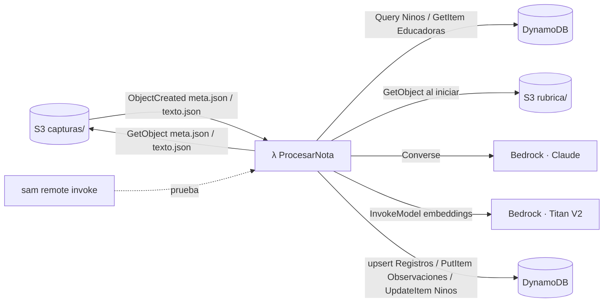

# Design Document — Procesador de notas de sala

## Overview
Una sola Lambda síncrona, disparada por eventos S3 del bucket de capturas (o por invocación directa para pruebas).
`meta.json` registra la captura; `texto.json` dispara el procesamiento (1 llamada para separar + por cada observación
particular: 1 para conductas y N para clasificar el código de manifestación), guarda en DynamoDB y devuelve el resultado.
Reglas de dominio en `.kiro/steering/dominio.md`; prompts en `src/prompts/`; esquemas en `src/schemas/`.



## Flujo del handler (disparo S3)
1. Por cada record S3: extraer `id_captura` de la clave `capturas/<id>/...` (validar `CAP-<ULID>`) y el sufijo del objeto.
2. Sufijo `meta.json` → leer meta, **upsert** `Registros` (estado `RECIBIDO`; id_educadora, sala_grupo, sala_key,
   fecha_observacion, tipo, claves S3, subido_en, actualizado_en).
3. Sufijo `texto.json` → `Registros` a `PROCESANDO`; leer `meta.json` (contexto) y `texto.json`; por cada parte de `partes[]`
   llamar `procesar_nota(id_captura, entrada, n_parte, archivo_s3)`; al terminar: `PROCESADO` con lista `errores` por parte
   (o `SIN_TEXTO` si no hay texto), `procesado_en`. `ERROR` (con `error`) solo si falla todo o es error de captura completa
   (`EDUCADORA_DESCONOCIDA`, `SALA_DESCONOCIDA`, `meta.json` ausente/ inválido).
4. **Invocación directa** (evento JSON con `texto/id_educadora/sala_grupo/fecha`): se procesa como captura de prueba; si no
   trae `id_captura`, se genera uno. Mismo contrato de salida.

### `texto.json`
```json
{"id_captura":"CAP-01J...","fuente":"ocr|audio|manual",
 "partes":[{"texto":"...","archivo":"original/foto1.jpg"}]}
```
- Cada **parte** es una llamada a `procesar_nota`; su `archivo` (relativo a la carpeta de la captura) se copia a cada
  observación de esa parte como clave S3 completa en `archivo_s3` (`capturas/{id_captura}/original/foto1.jpg`).
- `archivo` es **opcional** (una nota escrita por la tía no tiene archivo). Si `texto.json` trae solo `{"texto":"..."}` sin
  `partes`, se trata como una única parte sin archivo.

## Flujo de `pipeline.procesar_nota(id_captura, entrada, n_parte=0, archivo_s3=None)`
0. `id_captura` viene dado (de la ruta S3; en pruebas se genera). `id_obs = {id_captura}-p{n_parte}-{n_obs}` (determinista;
   un reintento sobrescribe, no duplica). `archivo_s3` se copia a cada observación de esta parte.
1. **Validar entrada** → errores de captura (`TEXTO_VACIO`, `EDUCADORA_DESCONOCIDA`, `SALA_DESCONOCIDA`).
2. **Contexto**: educadora → `id_jardin`; `Query Ninos` por `id_jardin`; filtrar `fecha_ingreso <= fecha`; separar
   `nomina` (sala pedida) y `resto_jardin`.
3. **Separar e identificar** (prompt `separar_identificar`, `MODEL_ID_SEPARAR`): nómina como `N1: Sofía M. — apodos: Sofi, la Sofi`.
   Validaciones: literal, cobertura, refs ∈ nómina, `nombres.resolver` confirma cada sujeto → `PARTICULAR` o `NO_IDENTIFICADO`;
   N sujetos → N observaciones.
4. Por cada particular identificada, en paralelo:
   a. **Conductas** (prompt `extraer_conductas`, `MODEL_ID_CONDUCTAS`) → si no evaluable, guardar y terminar.
   b. **Recuperar**: embeber cada `accion`, coseno contra las 90 manifestaciones (sin filtro de nivel), unir y recortar a `2*TOP_K`.
   c. **Clasificar** (prompt `clasificar`, `MODEL_ID_EVALUAR`) `N_CORRIDAS_EVALUAR` veces en paralelo, barajando candidatas.
      El prompt recibe las descripciones de los 9 niveles y los 9 ejemplos de `fewshot.json`. Devuelve SOLO códigos.
   d. **Cruzar y consolidar** (`postproceso.py`, sin IA): cada código → nivel, dominio, texto_observable desde `rubrica.json`;
      votación entre corridas → certeza y comentario (dominio.md §5).
   e. **Comparar con la edad** (`edad.py`, solo código): edad_meses, niveles_esperados, comparacion_edad; se agrega una frase al comentario.
5. **Guardar** todas las observaciones (GENERAL, PARTICULAR, NO_IDENTIFICADO) con `BatchWriteItem`; además `UpdateItem` en
   `Ninos` por cada niño/a con observación: `ultima_obs_fecha` siempre; `ultimo_nivel` y `ultimo_nivel_fecha` solo si hay nivel.
   Devolver el resultado.

## Componentes
```python
# edad.py  (solo código; el LLM nunca ve la edad)
def edad_meses(fecha_nac: date, f: date) -> int                         # fórmula del diccionario, >= 0
def niveles_esperados(edad: int, rubrica) -> tuple[list[int], bool]     # (niveles, fuera_de_rango_rubrica)
def comparar(nivel: int, esperados: list[int]) -> str                   # BAJO_LO_ESPERADO | ACORDE | SOBRE_LO_ESPERADO

# nombres.py  (rapidfuzz WRatio sobre nombre + apodos normalizados; match >= 88;
#              AMBIGUO si dos >= 88 o diferencia entre los dos mejores < 5)
def resolver(nombre_en_texto: str, nomina, resto_jardin) -> Resolucion

# llm.py
def call_json(prompt_id, variables, schema, model_id, temperature=None, max_tokens=2000) -> tuple[dict, LlmMeta]

# retriever.py
class Retriever:  # carga rubrica.json + embeddings_rubrica.json (S3 o local)
# rubrica.py: cruce código → {nivel, dominio, texto_observable} desde rubrica.json (diccionario, sin IA)
    def buscar(self, consulta: str, k: int) -> list[Candidata]   # sobre las 90, sin filtro

# capturas.py  (sin AWS; parseo puro, testeable)
def id_captura_de_clave(key: str) -> str   # 'capturas/CAP-.../texto.json' -> 'CAP-...'; valida CAP-<ULID>
def tipo_de_clave(key: str) -> str         # 'meta' | 'texto' | 'otro'
def clave_archivo(id_captura, archivo) -> str   # 'capturas/{id}/{archivo}' (clave S3 completa)

# datos.py  (dos implementaciones con la misma interfaz: DynamoDB y local con data/processed/)
def educadora(id) -> Educadora | None
def ninos_de_jardin(id_jardin) -> list[Nino]
def guardar_observaciones(lista, id_captura, cabecera) -> None   # Observaciones + UpdateItem Ninos
def upsert_registro(id_captura, campos: dict) -> None            # Registros (meta o estado), upsert

# handler.py
def handler(event, context) -> dict   # records S3 (meta/texto) o evento directo {"body": "<json>"} para pruebas
```

## Datos

### DynamoDB (on-demand)
| Tabla | PK | SK | GSI | Atributos |
|---|---|---|---|---|
| `Jardines` | `id_jardin` | — | — | nombre_fantasia, comuna, region, numero_salas (num), numero_educadoras (num), salas[] (sala_grupo distintos del jardín) |
| `Educadoras` | `id_educadora` | — | `porJardin` (PK id_jardin) | id_jardin, rol |
| `Ninos` | `id_jardin` | `id_nino` | `porJardin` (PK id_jardin) | sala_grupo, nombre, apodos[], fecha_nacimiento, fecha_ingreso, ultima_obs_fecha, ultimo_nivel, ultimo_nivel_fecha |
| `Registros` | `id_captura` | — | `porSala` (PK sala_key, SK subido_en) | tipo, claves S3, id_educadora, sala_grupo, sala_key, fecha_observacion, estado (`RECIBIDO`\|`PROCESANDO`\|`PROCESADO`\|`SIN_TEXTO`\|`ERROR`), texto_extraido, errores[], error, subido_en, procesado_en, actualizado_en |
| `Observaciones` | `id_captura` | `id_obs` | `porNino` (PK id_nino, SK orden), `porSala` (PK sala_key, SK orden) | fecha, orden (=`fecha#creado_en`), origen (`app`\|`dataset`), sala_key, id_educadora, id_jardin, sala_grupo, tipo, texto_literal, archivo_s3, id_nino, error_identificacion, candidatos[], evaluabilidad, motivo_no_evaluable, conductas[], sugerencias[], nivel, edad_meses, error_evaluacion, estado, llm_meta[], creado_en, validado_en |

**Fechas (ISO 8601; horas con zona `-03:00`):**
- `Registros`: `fecha_observacion` (día que la tía observó, de `meta.json`), `subido_en` (llegó `meta.json`), `procesado_en`
  (terminó el procesamiento), `actualizado_en`.
- `Observaciones`: `fecha` (día de la observación, el de `meta.json`), `creado_en` (al guardar), `validado_en` (si se valida).
- `orden = fecha#creado_en` usa la **fecha de la observación**, no la de subida: así "las 3 últimas de la sala" son las más
  recientes observadas, no las últimas en subirse.
- Escrituras a `Registros` = **upsert** (meta.json y texto.json pueden llegar en cualquier orden).

### S3 (2 buckets, acceso público bloqueado)
- **rubrica**: `rubrica/rubrica.json`, `rubrica/fewshot.json`, `rubrica/embeddings_rubrica.json`.
- **capturas** (nombre fijo con `!Sub` + `${AWS::AccountId}`, para evitar la dependencia circular con la notificación):
  `capturas/{id_captura}/meta.json`, `capturas/{id_captura}/original/…`, `capturas/{id_captura}/texto.json`.
  `meta.json` = `{id_educadora, sala_grupo, fecha_observacion, tipo, ...}`; `texto.json` = `{id_captura, fuente, partes:[{texto, archivo?}]}`.
  (Ya **no** se sube `raw/` al bucket.)

`rubrica.json` (ya generado en `data/processed/`; NO regenerar):
```json
{"version":"E1-2026-10-13","dominios":[...],
 "niveles":[{"nivel":1,"nombre_nivel":"...","edad_min_meses":0,"edad_max_meses":2,"descripcion":"..."}],
 "manifestaciones":{"MAN-L01-CO-01":{"nivel":1,"dominio":"cognitivo","texto_observable":"..."}, ...}}
```
`fewshot.json` (ya generado; texto tal cual de `consolidado.json`, protagonista = id_nino): 9 ejemplos `{protagonista, nota, respuesta}` donde `respuesta` cumple exactamente el esquema
`clasificar.json` (`manifestaciones`, `otro_codigo_viable`, `comentario`, `sin_correspondencia`). Se insertan en `{{ejemplos}}`
con el formato de `fewshot.json._formato` (Protagonista / Observación / Respuesta en JSON compacto). En los 9 ejemplos
`otro_codigo_viable` es null a propósito: cualquier código alternativo sería de la validación y la contaminaría.
Embeddings: se embebe `"<dominio>: <texto_observable>"` de cada código (sin el número de nivel, para no sesgar).

### Nombres de demo (ya escritos, no generar otros)
El dataset está anonimizado (solo IDs). Para probar la identificación con datos reales, `tests/fixtures/nomina_demo.json`
asigna nombres y apodos a los 26 niños/as REALES de JAR-0001 (salas SG-A y SG-B, con sus IDs, fechas y salas del dataset).
Incluye a propósito una variante de escritura (Nayara/"Naiara"), dos "Martina" en SG-A (AMBIGUO) y un "Joaquín" en SG-B
(FUERA_DE_SALA). Los demás niños/as del dataset quedan sin nombre (no se identifican por nombre en esta etapa).
Las notas de prueba están en `tests/fixtures/notas_prueba.json` (13 casos: separación, identificación y no evaluables; sin niveles).

## Contrato
Entrada (evento):
```json
{"texto":"Sofi y Pedro clasificaron hojas por tamaño. Hoy bajó la asistencia, mucha tos.",
 "id_educadora":"EDU-0001","sala_grupo":"SG-A","fecha":"2026-10-14"}
```
Salida:
```json
{"id_captura":"CAP-01J...","advertencias":[],
 "observaciones":[
  {"id_obs":"OBS-01JA…","tipo":"PARTICULAR","id_nino":"NINO-00123","texto_literal":"Sofi y Pedro clasificaron hojas por tamaño",
   "edad_meses":31,"evaluabilidad":"EVALUABLE",
   "nivel":9,"certeza":"alta","manifestaciones":[{"id_manifestacion":"MAN-L09-CO-02","nivel":9,"dominio":"cognitivo",
     "texto_observable":"Clasifica objetos por una característica visible…","certeza":"alta",
     "frase_evidencia":"clasificaron hojas por tamaño"}],
     "comentario":"Clasifica por una característica visible (tamaño) tras la actividad: nivel 9. Para su edad (31 meses) lo esperado es el nivel 9.",
     "niveles_esperados":[9],"comparacion_edad":"ACORDE",
   "estado":"SUGERIDO"},
  {"id_obs":"OBS-01JB…","tipo":"NO_IDENTIFICADO","texto_literal":"Sofi y Pedro clasificaron hojas por tamaño",
   "error_identificacion":"AMBIGUO",
   "candidatos":[{"id_nino":"NINO-00145","nombre":"Pedro A.","score":95},{"id_nino":"NINO-00160","nombre":"Pedro R.","score":95}]},
  {"id_obs":"OBS-01JC…","tipo":"GENERAL","texto_literal":"Hoy bajó la asistencia, mucha tos."}]}
```
Error de captura: `{"error":{"codigo":"SALA_DESCONOCIDA","mensaje":"..."}}`.

**Disparo por S3** (producción): el evento es un record `ObjectCreated` con la clave `capturas/<id_captura>/texto.json` (o
`.../meta.json`). El handler lee los objetos de S3; no devuelve JSON al llamador (el resultado queda en DynamoDB). La
**invocación directa** (evento JSON de arriba) sigue para pruebas, con `id_captura` opcional (si falta, se genera).

### Formato de las variables de los prompts (strings que arma `pipeline.py`)
- `{{nomina}}`: una línea por niño/a: `N1: Sofía M. — apodos: Sofi, la Sofi` (sin apodos: `N5: Pascal`). Las refs N1… son
  internas a la llamada; nunca se envía el `id_nino`.
- `{{niveles_descripcion}}`: una línea por nivel: `Nivel 8 — Combinación y participación: <descripcion>`. **Sin rangos de
  edad** (el LLM no debe tener pistas de edad).
- `{{candidatas}}`: una línea por código: `MAN-L08-LC-01 | lenguaje_comunicacion | <texto_observable>`, barajadas por corrida.
- `{{conductas_json}}`: la lista `conductas` devuelta por `extraer_conductas`, en JSON compacto.
- `{{ejemplos}}`: según `fewshot.json._formato`, separados por una línea en blanco.
- IDs: `id_captura = CAP-<ulid>` (de la ruta S3); `id_obs = {id_captura}-p{n_parte}-{n_obs}` (determinista; los `OBS-…` del contrato son ilustrativos).

## Manejo de errores
| Situación | Comportamiento |
|---|---|
| Entrada inválida | error de captura, sin llamar al LLM |
| JSON inválido del LLM | 1 reintento con el error; luego `error_evaluacion = LLM_SALIDA_INVALIDA` en esa observación (el resto sigue) |
| Throttling Bedrock | backoff exponencial (máx. 4 intentos) |
| Fragmento no identificable | `NO_IDENTIFICADO` (no es falla del sistema) |
| Captura sin `texto.json` aún | `Registros` queda en `RECIBIDO` (solo llegó `meta.json`) |
| Una parte falla | las demás siguen; `Registros.estado = PROCESADO` con esa parte en `errores[]` |
| Error de captura completa | `EDUCADORA_DESCONOCIDA` / `SALA_DESCONOCIDA` / `meta.json` ausente o inválido → `Registros.estado = ERROR`, código en `error` |
| Falla inesperada | log con `id_captura` y tipo de excepción (sin texto) y respuesta `{"error":{"codigo":"ERROR_INTERNO"}}` |

## Pruebas
- Unitarias: edad (tabla de referencia de `dominio.md` §1), nombres (apodos, tildes, "Naiara/Nayara", duplicados, fuera de sala),
  validaciones literales, consolidación de corridas (nivel, certeza, comentario), edad y comparación (tabla de `dominio.md` §1),
  `capturas.py` (parseo de clave: id_captura, tipo, validación de formato).
- LLM (`-m llm`): los 13 casos de `tests/fixtures/notas_prueba.json` con `tests/fixtures/nomina_demo.json`.
- `scripts/pipeline_local.py --texto "..." --educadora EDU-0001 --sala SG-A --fecha 2026-10-15` y `--casos tests/fixtures/notas_prueba.json` (corre todos e imprime tabla esperado vs obtenido).
- En AWS: `events/nota_ejemplo.json` + `sam remote invoke` (invocación directa); y `scripts/subir_captura_prueba.py` que sube
  `meta.json` + `texto.json` de una captura `CAP-<ULID>` para probar el disparo S3 sin OCR, verificando `Registros` y `Observaciones`.
