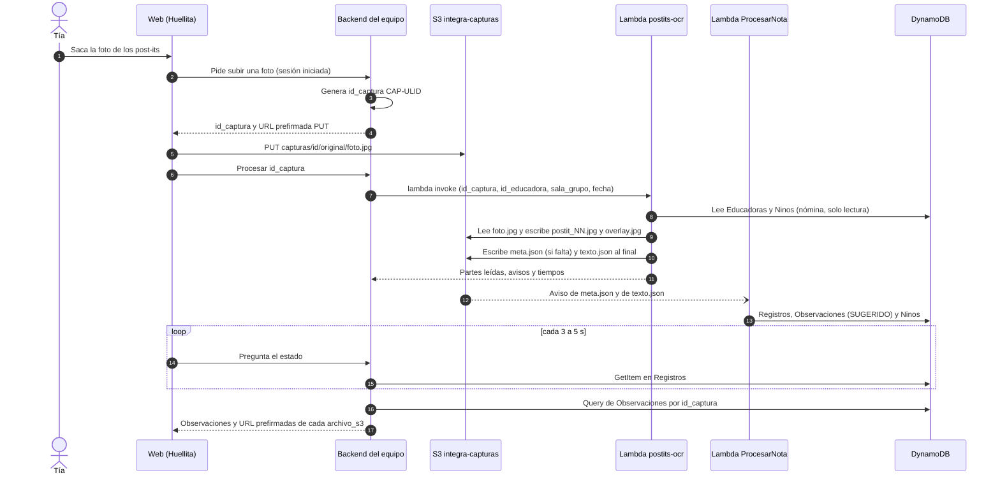

# `postits-ocr`: qué recibe, qué deja y cómo integrarla con SAM

> Nota: las rutas que empiezan con `.agents/` o `c:\Users\crist\...` son de la máquina donde se desarrolló y probó el módulo; esos archivos no están en el repo.

> Estado al 15-10-2026. Manda el código de la rama `feature/postits-ocr` (commit `83547ae`, carpeta `postits-ocr/` del
> repo), que es el que corre en AWS: los 8 módulos del zip desplegado son idénticos byte a byte a los del commit. Los
> ejemplos salen de la prueba real `CAP-01M50JVN0CBE1Q6A8P3BCWYRBN` (foto `Prueba2.jpeg`, 9 post-its, educadora
> `EDU-0001`, sala `SG-A`). Los datos de la demo son sintéticos, pero el sistema es para datos de niños.
> Lo que no se comprobó dice **no verificado**.

## 1. Resumen

`postits-ocr` es una Lambda que recibe el `id_captura` de una foto que ya está en S3, separa los post-its con OpenCV, lee
cada uno con Bedrock (Claude Haiku 4.5) y deja en `capturas/{id_captura}/` un recorte por post-it, `meta.json` (si falta)
y `texto.json`. No escribe en DynamoDB: al aparecer `texto.json`, S3 dispara `ProcesarNota` (stack `integra-procesador`),
que identifica al niño, clasifica y llena `Registros`, `Observaciones` y `Ninos`. En la prueba, `postits-ocr` respondió en
3,3 s y `ProcesarNota` terminó unos 25 s después.



El flujo de `docs/integracion_postits.mmd` es anterior: hoy `postits-ocr` no identifica niños ni sugiere niveles, y el
backend no llama a otra Lambda por post-it. Eso lo hace `ProcesarNota` sola, a partir de `texto.json`.

## 2. Recursos desplegados hoy

Verificado el 15-10-2026 con llamadas de solo lectura (`describe_stacks`, `get_function_configuration`, IAM y S3).

| Recurso | Detalle |
|---|---|
| Cuenta y región | `277702547089`, `us-east-1` |
| Stack `postits-ocr` | `UPDATE_COMPLETE`, etiqueta `proyecto=postits-ocr`. Plantilla `postits-ocr/infra/plantilla.json` (CloudFormation puro, sin SAM) con 3 recursos: `Funcion`, `Rol` y `GrupoLogs`. |
| Lambda `postits-ocr` | `arn:aws:lambda:us-east-1:277702547089:function:postits-ocr`: `python3.12`, `x86_64`, handler `ocr.handler`, 2048 MB, timeout 60 s, `/tmp` de 512 MB. Sin concurrencia reservada, sin política de recursos y sin Function URL. |
| Código | `s3://postits-ocr-despliegue-277702547089/lambda/postits-ocr-3ab414f75c4646b2.zip`: 77,9 MiB comprimido y 226,5 MiB descomprimido (el límite de Lambda es 250 MiB). Trae numpy 2.4.6, opencv-python-headless 4.14.0.94, pillow 12.3.0, tzdata 2026.5, python-ulid 4.0.1 y `capturas_equipo.py` (copia de `integra-backend/src/core/capturas.py`). boto3 es el del runtime. |
| Rol | `postits-ocr-Rol-CcWsZAiu7VRK`, solo con la política inline `postits-ocr-minimo` (sus permisos están en 6.2). No puede escribir en DynamoDB. |
| Logs | `/aws/lambda/postits-ocr`, retención de 7 días. Solo ids, conteos, tiempos y códigos: nunca textos leídos ni nombres. |
| Bucket de despliegue | `postits-ocr-despliegue-277702547089` (privado, SSE-S3), con el zip actual y uno anterior. |
| Del equipo (solo se usan) | Bucket `integra-capturas-277702547089` (solo bajo `capturas/`), tabla `integra-procesador-TablaEducadoras-PMJ55I44WU75` (`GetItem`), tabla `integra-procesador-TablaNinos-11AMEMFM7SFST` (`Query`) y el perfil de Bedrock `us.anthropic.claude-haiku-4-5-20251001-v1:0`. |

En la prueba real la función duró 3290 ms y usó 224 MB de memoria. El arranque en frío, medido en el ensayo, fue de 754 ms.

Variables de entorno: son las 7 de `plantilla.json`, con los valores de la función desplegada.

| Variable | Valor | Para qué |
|---|---|---|
| `POSTITS_BUCKET` | `integra-capturas-277702547089` | Bucket de capturas. Si falta, la respuesta es `CONFIGURACION`. |
| `BEDROCK_MODEL_ID` | `us.anthropic.claude-haiku-4-5-20251001-v1:0` | Modelo de lectura (también es el valor por defecto del código). |
| `TABLA_EDUCADORAS` | `integra-procesador-TablaEducadoras-PMJ55I44WU75` | `GetItem` para saber el `id_jardin` de la educadora. |
| `TABLA_NINOS` | `integra-procesador-TablaNinos-11AMEMFM7SFST` | `Query` por `id_jardin` con filtro `sala_grupo`: nombres y apodos que ayudan a leer la letra. |
| `POSTITS_PLAZO_LECTURA_S` | `30` | Plazo total de la lectura, en segundos (20 si falta). Se acorta para dejar 20 s antes del timeout. |
| `POSTITS_HILOS_LECTURA` | `8` | Recortes que se leen en paralelo (1 a 16). |
| `POSTITS_LOG` | `INFO` | Nivel de log. |

El código también lee `POSTITS_FUENTE_NOMINA` (`aws` o `local`) y `POSTITS_NOMINA_LOCAL` (JSON de nómina para pruebas
locales). En AWS no están definidas.

## 3. Entrada

### 3.1 Cómo se invoca

Invocación síncrona (`RequestResponse`) con un evento JSON. `ocr.handler` acepta:

- la petición tal cual, que es lo normal con `lambda invoke`;
- la petición envuelta como la manda API Gateway, `{"body": "<json en texto>"}` o `{"body": {...}}`. Si `body` no es JSON,
  responde `PETICION_INVALIDA` (campo `body`);
- un evento S3 (con `Records`), que hoy no se procesa (3.5).

La foto nunca va en el evento: tiene que estar en S3 antes de invocar.

```powershell
aws lambda invoke --function-name postits-ocr --region us-east-1 `
  --cli-binary-format raw-in-base64-out --cli-read-timeout 90 `
  --payload file://peticion.json respuesta.json
```

```python
import json

import boto3
from botocore.config import Config

# read_timeout mayor que los 60 s de la Lambda y sin reintentos: un reintento procesaría la captura dos veces.
lam = boto3.client("lambda", region_name="us-east-1",
                   config=Config(read_timeout=90, retries={"max_attempts": 0}))
r = lam.invoke(FunctionName="postits-ocr", InvocationType="RequestResponse",
               Payload=json.dumps(peticion).encode())
cuerpo = json.loads(r["Payload"].read())
if r.get("FunctionError"):   # timeout o caída: lo arma Lambda y no trae {"error": {"codigo": ...}}
    ...
elif "error" in cuerpo:      # error del contrato (tabla de 4.3)
    ...
```

### 3.2 Campos de la petición

Son las reglas exactas de `captura.validar_peticion`. Un campo con valor `null` cuenta como ausente y los campos
desconocidos se ignoran.

| Campo | Tipo | Obligatorio | Por defecto | Reglas |
|---|---|---|---|---|
| `id_captura` | string | sí, salvo que venga `s3_key` | | `CAP-` + ULID: tiene que calzar completo con `CAP-[0-9A-HJKMNP-TV-Z]{26}` y pasar `es_id_captura` del equipo. |
| `s3_key` | string | no (alternativa a `id_captura`) | | Hasta 1024 caracteres, patrón `capturas/[A-Za-z0-9!_.*'()/-]+`, termina en `.jpg`, `.jpeg` o `.png` (sin importar mayúsculas) y sin segmentos vacíos, `.` ni `..`. Si termina en `.heic` o `.heif`, el error es `FORMATO_NO_SOPORTADO`. Si la carpeta es `CAP-...`, el id tiene que ser válido, la forma exacta `capturas/{id}/original/<nombre>` y `<nombre>` no puede ser `postit_<n>.jpg` ni `overlay.jpg`. Si viene junto con `id_captura`, tienen que coincidir. |
| `id_educadora` | string | sí, si la carpeta no tiene `meta.json` | | `[A-Za-z0-9_-]{1,64}`. Si hay `meta.json`, manda el de `meta.json`. |
| `sala_grupo` | string | igual que `id_educadora` | | `[A-Za-z0-9_-]{1,64}`. Si hay `meta.json`, manda el de `meta.json`. |
| `id_jardin` | string | no | | `[A-Za-z0-9_-]{1,64}`. Solo se compara con el jardín de la educadora: sin `meta.json`, si no coincide, `PETICION_INVALIDA`. |
| `fecha_observacion` | string | no | hoy en `America/Santiago` | `AAAA-MM-DD`, fecha real, entre `2020-01-01` y hoy (hora de Chile). Si hay `meta.json`, manda la de `meta.json`. |
| `modo` | string | no | `opencv` | `opencv` o `llm`. `llm` salta OpenCV y hace que Bedrock lea la foto completa (Plan B). |
| `escribir_texto` | boolean | no | `true` | Solo booleano JSON. `false` es el ensayo en seco: escribe las imágenes, pero no `meta.json` ni `texto.json`. |
| `incluir_urls` | boolean | no | `false` | Solo booleano JSON. `true` agrega URL prefirmadas de 1 h de cada recorte y del overlay. |

De dónde sale el `id_captura`, en este orden:

1. Si `s3_key` está dentro de `capturas/CAP-.../original/`, se usa el de la ruta.
2. Si no, el `id_captura` de la petición.
3. Si solo viene un `s3_key` fuera de una carpeta `CAP-` (por ejemplo `capturas/entrada/IMG_0412.jpg`), la Lambda genera
   uno con `f"CAP-{ULID()}"` y lo devuelve en la respuesta. Para reintentar hay que pasar ese id; si no, se crea otra
   captura.

### 3.3 La foto antes de invocar

- **Dónde:** bucket `integra-capturas-277702547089`, clave `capturas/{id_captura}/original/foto.jpg`. Con solo
  `id_captura`, la Lambda busca `original/foto.jpg`, después `original/foto.jpeg` y después `original/foto.png`. Cualquier
  otro nombre necesita `s3_key`.
- **Copia:** si el origen no es `original/foto.jpg` (por ejemplo `foto.png` o un `s3_key` fuera de la carpeta), la Lambda
  deja una copia en `original/foto.jpg`: el JPEG tal cual y el PNG recodificado a JPEG con calidad 92. La copia lleva los
  metadatos `origen=postits-ocr` y `fuente=<clave de origen>`. El archivo original no se borra.
- **Formato:** el contenido se abre con Pillow y se aplica la orientación EXIF. JPEG está probado en AWS; PNG, no
  verificado en AWS.
- **Se rechaza:** HEIC o HEIF, por la extensión del `s3_key` o por la firma del archivo (`FORMATO_NO_SOPORTADO`; las fotos
  de iPhone hay que pasarlas a JPEG); más de 25 MiB (`IMAGEN_DEMASIADO_GRANDE`); un archivo que Pillow no abre
  (`IMAGEN_NO_DECODIFICABLE`).
- **Para que OpenCV encuentre los post-its:** amarillos, naranjos, rosados, verdes o celestes, sobre un fondo neutro, cada
  uno entre el 0,3 % y el 40 % de la foto. Si no encuentra ninguno, Bedrock lee la foto completa (aviso `PLAN_B`).

### 3.4 Ejemplos de petición

`CAP-01ARZ3NDEKTSV4RRFFQ69G5FAV` es un id de ejemplo: con él la Lambda responde `IMAGEN_NO_ENCONTRADA` y no escribe nada.

Normal (la misma forma que usó la prueba real):

```json
{"id_captura": "CAP-01ARZ3NDEKTSV4RRFFQ69G5FAV", "id_educadora": "EDU-0001", "sala_grupo": "SG-A", "fecha_observacion": "2026-10-15"}
```

Ensayo en seco, con las URL de los recortes (escribe imágenes, no dispara `ProcesarNota`):

```json
{"id_captura": "CAP-01ARZ3NDEKTSV4RRFFQ69G5FAV", "id_educadora": "EDU-0001", "sala_grupo": "SG-A", "escribir_texto": false, "incluir_urls": true}
```

Modo `llm` (Plan B forzado):

```json
{"id_captura": "CAP-01ARZ3NDEKTSV4RRFFQ69G5FAV", "id_educadora": "EDU-0001", "sala_grupo": "SG-A", "modo": "llm"}
```

Foto subida en otra clave (la Lambda genera el id y copia la foto a `original/foto.jpg`):

```json
{"s3_key": "capturas/entrada/IMG_0412.jpg", "id_educadora": "EDU-0001", "sala_grupo": "SG-A", "fecha_observacion": "2026-10-15"}
```

Envuelta como la manda API Gateway:

```json
{"body": "{\"id_captura\": \"CAP-01ARZ3NDEKTSV4RRFFQ69G5FAV\", \"id_educadora\": \"EDU-0001\", \"sala_grupo\": \"SG-A\"}"}
```

### 3.5 Eventos S3, hoy

Si el evento trae una lista `Records`, el handler no lee ni escribe nada y responde una entrada por record:

```json
{"procesados": [{"id_captura": null, "estado": "ignorada", "motivo": "disparador S3 no habilitado"}]}
```

Hoy ninguna notificación del bucket apunta a `postits-ocr` (solo `meta.json` y `texto.json` van a `ProcesarNota`,
verificado) y la función no tiene permiso para que S3 la invoque. Activarlo es pendiente de código (sección 7).

## 4. Salida

### 4.1 Respuesta de la invocación

| Campo | Tipo | Qué es |
|---|---|---|
| `id_captura` | string | El id usado: el pedido o el generado. |
| `prefijo` | string | `capturas/{id_captura}/` |
| `n_postits` | int | Cantidad de partes (igual a `len(partes)`). |
| `modo` | string | `opencv` (un recorte por post-it) o `llm` (Plan B: todas las partes apuntan a `original/foto.jpg`). |
| `giro_grados` | int | Giro horario que se aplicó a la foto antes de recortar: `0`, `90`, `180` o `270` (`270` es 90° antihorario). Los recortes y el overlay quedan derechos; `foto.jpg` queda como se subió. |
| `partes[]` | lista | Una por post-it, en orden de lectura: filas de arriba abajo y cada fila de izquierda a derecha. |
| `partes[].orden` | int | De 1 a N. La parte con `orden` N es la `n_parte` N-1 de `ProcesarNota` (4.6). |
| `partes[].archivo` | string | Relativo a la carpeta: `original/postit_NN.jpg`, o `original/foto.jpg` en el Plan B. |
| `partes[].texto` | string | Texto literal, con saltos `\n` y `[ilegible]` donde no se lee. Nunca vacío. |
| `partes[].legibilidad` | string | `alta`, `media` o `baja`. |
| `partes[].color` | string | `amarillo`, `naranjo`, `rosado`, `verde`, `celeste` o `desconocido`. |
| `partes[].url` | string | Solo con `incluir_urls`: GET prefirmado de 1 h. |
| `overlay_url` | string | Solo con `incluir_urls`: GET prefirmado de 1 h del overlay. |
| `tiempos_ms` | objeto | `deteccion` (detectar, orientar con 2 consultas a Bedrock, recortar y dibujar el overlay), `lectura`, `subida` (esperar las imágenes y escribir los JSON) y `total`, en milisegundos. |
| `meta_escrito` | bool | `true` si esta invocación escribió `meta.json`. |
| `texto_escrito` | bool | `true` si escribió `texto.json`, o sea, si `ProcesarNota` va a correr. |
| `avisos` | lista de string | `"CODIGO"` o `"CODIGO: detalle"`, sin textos ni nombres (4.2). |
| `documentos` | objeto | Solo en el ensayo en seco: `{"meta.json": ..., "texto.json": ...}`, con `meta.json` en `null` si ya existía. |

Respuesta real (`real.json`), recortada a 4 de las 9 partes:

```json
{
 "id_captura": "CAP-01M50JVN0CBE1Q6A8P3BCWYRBN",
 "prefijo": "capturas/CAP-01M50JVN0CBE1Q6A8P3BCWYRBN/",
 "n_postits": 9,
 "modo": "opencv",
 "giro_grados": 270,
 "partes": [
  {"orden": 1, "archivo": "original/postit_01.jpg", "texto": "Benja y Emi compartieron\nlas palas en el arenero", "legibilidad": "alta", "color": "naranjo"},
  {"orden": 2, "archivo": "original/postit_02.jpg", "texto": "Pedri ToSalTo con los dos\npies en el paTio", "legibilidad": "media", "color": "verde"},
  {"orden": 3, "archivo": "original/postit_03.jpg", "texto": "Vicho: se pasor el somgeo\nde una mano a la otra", "legibilidad": "media", "color": "rosado"},
  {"orden": 4, "archivo": "original/postit_04.jpg", "texto": "Pascal: armó una Torre\nde 5 bloques sin ayuda", "legibilidad": "alta", "color": "amarillo"}
 ],
 "tiempos_ms": {"deteccion": 924, "lectura": 2082, "subida": 69, "total": 3287},
 "meta_escrito": true,
 "texto_escrito": true,
 "avisos": []
}
```

### 4.2 Avisos

| Aviso | Qué significa |
|---|---|
| `META_EXISTENTE` | Ya había `meta.json` (o apareció durante la invocación): se usaron sus valores y no se reescribió. |
| `META_EXISTENTE_DIFIERE: <campo>` | La petición traía otro `id_educadora`, `sala_grupo` o `fecha_observacion`, y ganó `meta.json`. |
| `META_FECHA_NO_ESTANDAR` | La fecha de `meta.json` no es `AAAA-MM-DD`: la nómina no se filtra por `fecha_ingreso`. |
| `ID_JARDIN_IGNORADO` | El `id_jardin` no coincide con el de la educadora (había `meta.json`). |
| `NOMINA_NO_DISPONIBLE: <detalle>` | Se leyó sin los nombres de la sala: educadora o sala desconocida con `meta.json`, o falla de DynamoDB. |
| `ORIENTACION_INCIERTA` | No se supo hacia dónde está la letra: todas las partes quedan `[ilegible]` con legibilidad `baja` y `texto.json` se escribe igual. Conviene repetir la foto. |
| `LECTURA_FALLIDA: orden N (<tipo>)` | Falló la lectura de ese recorte, que queda `[ilegible]`. |
| `LECTURA_NO_JSON: orden N` | El modelo no devolvió JSON: queda su texto crudo (hasta 500 caracteres) con legibilidad `baja`. |
| `PLAN_B: modo llm` o `PLAN_B: opencv no detecto post-its` | Se leyó la foto completa. |
| `SIN_POSTITS` | El Plan B no encontró post-its: `texto.json` va con `partes: []` y `ProcesarNota` deja `SIN_TEXTO`. |
| `TEMPERATURA_NO_SOPORTADA` | El modelo rechazó `temperature` y se leyó sin ese parámetro. |
| `ESCRITURA_NO_CONDICIONAL` | El boto3 del runtime no soporta `IfNoneMatch`: `meta.json` se escribió sin condición. |
| `TEXTO_REESCRITO` | Ya había un `texto.json` de `postits-ocr` y se reemplazó: `ProcesarNota` procesa de nuevo. |
| `URLS_NO_DISPONIBLES` | Falló la firma de las URL. La captura igual quedó bien. |

### 4.3 Errores

Forma: `{"error": {"codigo": "...", "mensaje": "..."}, "id_captura": "CAP-..."}`. `id_captura` viene solo si ya se conocía
(después de validar la petición) y `mensaje` nombra el campo, nunca el valor.

```json
{"error": {"codigo": "IMAGEN_NO_ENCONTRADA", "mensaje": "la captura no tiene original/foto.(jpg|jpeg|png)"}, "id_captura": "CAP-01ARZ3NDEKTSV4RRFFQ69G5FAV"}
```

| Código | Cuándo | Qué quedó escrito | ¿Se reintenta? |
|---|---|---|---|
| `PETICION_INVALIDA` | `body` no es JSON ni objeto; un campo no cumple 3.2; faltan `id_captura` y `s3_key`; falta `id_educadora` o `sala_grupo` y no hay `meta.json`; `id_jardin` no es el de la educadora y no hay `meta.json`; la carpeta ya tiene un `texto.json` que no escribió `postits-ocr`; el `s3_key` apunta a otra foto y la carpeta ya tiene un `foto.jpg` distinto. | Nada | Sí, corrigiendo la petición |
| `FORMATO_NO_SOPORTADO` | HEIC o HEIF, por extensión o por firma. | Nada | Sí, con JPEG o PNG |
| `IMAGEN_NO_ENCONTRADA` | No hay `original/foto.(jpg\|jpeg\|png)`, el `s3_key` no existe o S3 responde 404/403 al leer la foto. | Nada | Sí, cuando la foto esté subida |
| `IMAGEN_DEMASIADO_GRANDE` | La foto pesa más de 25 MiB. | Nada | Sí, con una foto más liviana |
| `IMAGEN_NO_DECODIFICABLE` | Pillow no abre el archivo. | Nada | No con el mismo archivo |
| `META_INVALIDA` | El `meta.json` que ya estaba no es JSON, pesa más de 1 MiB o no cumple `Meta` del equipo (`id_educadora` o `sala_grupo` que no son texto, `fecha_observacion` ausente o que no es un valor simple, `tipo` que no es texto). | Nada, o las imágenes si `meta.json` apareció a mitad de camino | Sí, arreglando `meta.json` |
| `EDUCADORA_DESCONOCIDA` | Sin `meta.json`: la educadora no está en `Educadoras` o no tiene `id_jardin`. | Nada | Sí, con un `id_educadora` válido |
| `SALA_DESCONOCIDA` | Sin `meta.json`: ningún niño de esa sala tiene `fecha_ingreso` igual o anterior a la fecha. | Nada | Sí, con la sala correcta |
| `LECTURA_NO_DISPONIBLE` | Fallaron todas las lecturas de recortes, o falló la lectura de la foto completa (Plan B). | Las imágenes, nunca los JSON | Sí, con el mismo `id_captura` |
| `ERROR_ALMACENAMIENTO` | S3 falla al listar, leer o escribir (fuera de los 404/403/412/409 previstos). | Parcial: imágenes y quizás `meta.json`, nunca `texto.json` | Sí, con el mismo `id_captura` |
| `CONFIGURACION` | Falta `POSTITS_BUCKET`. | Nada | No: hay que arreglar el despliegue |
| `ERROR_INTERNO` | Cualquier otra excepción (un bug). | Parcial | Revisar los logs primero |
| `FunctionError` (no es un `codigo`) | Timeout de 60 s o caída del runtime; lo pone Lambda en la respuesta de `invoke`, no el handler. | Parcial | Mirar `Registros` antes: `texto.json` pudo alcanzar a escribirse |

Si se escribió `meta.json` pero no `texto.json`, `ProcesarNota` deja la fila en `RECIBIDO` hasta que se reintente.

### 4.4 Objetos en S3

Orden de escritura dentro de `capturas/{id_captura}/`:

| Paso | Clave | Quién | Detalle |
|---|---|---|---|
| 0 | `original/foto.jpg` | La web o el backend (o la copia de la Lambda, 3.3) | Antes de invocar. |
| 1 | `original/postit_01.jpg` … `original/postit_NN.jpg` | `postits-ocr` | Solo en modo `opencv`: un recorte derecho por post-it, en orden de lectura, JPEG calidad 90. |
| 2 | `original/overlay.jpg` | `postits-ocr` | La foto con cada post-it marcado y numerado, lado mayor 1600 px. |
| 3 | `meta.json` | `postits-ocr`, solo si no existe y `escribir_texto` es `true` | Escritura condicional (`IfNoneMatch="*"`), después de todas las imágenes. Dispara `ProcesarNota`: fila `RECIBIDO`. |
| 4 | `texto.json` | `postits-ocr`, si `escribir_texto` es `true` | Siempre lo último. Dispara el procesamiento. |

Las imágenes se suben en paralelo y la Lambda espera que estén todas antes de escribir cualquier JSON. Todo lo que escribe
lleva el metadato `origen=postits-ocr`, `ContentType` `image/jpeg` o `application/json; charset=utf-8`, y queda cifrado con
el SSE-S3 del bucket (verificado con `head_object`).

Carpeta real de la prueba (13 objetos, tamaños en bytes):

```text
capturas/CAP-01M50JVN0CBE1Q6A8P3BCWYRBN/
  original/foto.jpg         162995   subida por prueba_e2e.py (sin metadato origen)
  original/postit_01.jpg     10587   ... hasta postit_09.jpg (entre 7068 y 11458 bytes)
  original/overlay.jpg      279080
  meta.json                    107
  texto.json                  1299
```

### 4.5 `meta.json` y `texto.json`

`meta.json` real. `postits-ocr` escribe exactamente estos 4 campos (`captura.validar_meta_propio`):

```json
{"id_educadora": "EDU-0001", "sala_grupo": "SG-A", "fecha_observacion": "2026-10-15", "tipo": "foto"}
```

Si lo escribe otro (la web o el backend), rige `Meta` del equipo (`core/modelos.py`): `id_educadora`, `sala_grupo` y
`fecha_observacion` (`AAAA-MM-DD`) obligatorios, `tipo` opcional y los campos extra se ignoran. `postits-ocr` nunca lo
sobrescribe.

`texto.json` real, recortado a 4 de las 9 partes:

```json
{
 "id_captura": "CAP-01M50JVN0CBE1Q6A8P3BCWYRBN",
 "fuente": "ocr",
 "partes": [
  {"texto": "Benja y Emi compartieron\nlas palas en el arenero", "archivo": "original/postit_01.jpg", "legibilidad": "alta"},
  {"texto": "Pedri ToSalTo con los dos\npies en el paTio", "archivo": "original/postit_02.jpg", "legibilidad": "media"},
  {"texto": "Vicho: se pasor el somgeo\nde una mano a la otra", "archivo": "original/postit_03.jpg", "legibilidad": "media"},
  {"texto": "Pascal: armó una Torre\nde 5 bloques sin ayuda", "archivo": "original/postit_04.jpg", "legibilidad": "alta"}
 ]
}
```

Reglas (`captura.validar_texto`, más estricta que `TextoCaptura` del equipo):

- `id_captura` es el de la carpeta y `fuente` es `"ocr"`.
- `partes[]` tiene una parte por post-it, en orden de lectura. La posición en la lista (desde 0) es la `n_parte` de
  `ProcesarNota`: Pascal es `partes[3]`, y sus observaciones son `...-p3-...`.
- `texto`: literal y nunca vacío. `archivo`: relativo, empieza con `original/` y es una clave que existe (el recorte, o
  `original/foto.jpg` en el Plan B). `legibilidad`: `alta`, `media` o `baja` (`ProcesarNota` la ignora).
- Si no hay post-its, `partes` va vacío y `ProcesarNota` deja `SIN_TEXTO`.

### 4.6 Lo que deja `ProcesarNota` en DynamoDB

`postits-ocr` no toca estas tablas: lo escribe `ProcesarNota` cuando aparecen `meta.json` y `texto.json`.

#### `Registros` (`integra-procesador-TablaRegistros-P238ZZKPTQ51`)

Clave `id_captura`. Índice `porSala`: `sala_key` + `subido_en`.

| Cuándo | `estado` | Qué escribe |
|---|---|---|
| Aparece `meta.json` | `RECIBIDO`, solo si la fila no tenía estado | `id_educadora`, `sala_grupo`, `sala_key` (`{id_jardin}#{sala_grupo}`), `fecha_observacion`, `tipo`, `clave_meta`, `subido_en` |
| Aparece `texto.json` | `PROCESANDO` | `clave_texto` |
| Termina | `PROCESADO`, `SIN_TEXTO` o `ERROR` | `procesado_en`. Con `PROCESADO`, `errores` (lista de `{n_parte, error}`, vacía si todo salió bien). Con `ERROR`, `error` (`META_INVALIDA`, `TEXTO_INVALIDO`, `EDUCADORA_DESCONOCIDA` o `SALA_DESCONOCIDA`) si falló la captura completa, o `errores` si fallaron todas las partes. |

Cada escritura actualiza `actualizado_en`. Fila real (se vio `PROCESANDO` y después `PROCESADO`; de `subido_en` a
`procesado_en` pasaron 25 s):

```json
{
 "id_captura": "CAP-01M50JVN0CBE1Q6A8P3BCWYRBN",
 "estado": "PROCESADO",
 "id_educadora": "EDU-0001",
 "sala_grupo": "SG-A",
 "sala_key": "JAR-0001#SG-A",
 "fecha_observacion": "2026-10-15",
 "tipo": "foto",
 "clave_meta": "capturas/CAP-01M50JVN0CBE1Q6A8P3BCWYRBN/meta.json",
 "clave_texto": "capturas/CAP-01M50JVN0CBE1Q6A8P3BCWYRBN/texto.json",
 "subido_en": "2026-10-15T17:25:05-03:00",
 "procesado_en": "2026-10-15T17:25:30-03:00",
 "actualizado_en": "2026-10-15T17:25:30-03:00",
 "errores": []
}
```

#### `Observaciones` (`integra-procesador-TablaObservaciones-1MP6ZR2QT9JAU`)

Clave `id_captura` + `id_obs`. Índices `porNino` (`id_nino` + `orden`) y `porSala` (`sala_key` + `orden`), con proyección
completa.

- `id_obs` es `{id_captura}-p{n_parte}-{n_obs}`: `n_parte` es la posición de la parte en `texto.json` desde 0 (el `orden`
  de la respuesta menos 1) y `n_obs` es la observación dentro de esa parte, desde 0. Reprocesar la misma captura sobrescribe
  las filas con el mismo `id_obs`, pero no borra las que ya no salgan.
- Un post-it puede dar varias filas (dos niños en uno, o una nota que `ProcesarNota` parte en dos), todas con el mismo
  `archivo_s3`.
- Los atributos `null` no se guardan: si un campo falta, no aplica. Los números son tipo `N` (`Decimal` en boto3).
- Las filas `NO_IDENTIFICADO` y `GENERAL` no tienen `id_nino`: no salen en `porNino`, sí en `porSala`.

| Campo | Qué es |
|---|---|
| `tipo` | `PARTICULAR`, `GENERAL` o `NO_IDENTIFICADO`. |
| `texto_literal` | El fragmento como lo separó `ProcesarNota` (puede cambiar los saltos de línea del post-it). |
| `id_nino` | El niño identificado (solo `PARTICULAR`). |
| `error_identificacion`, `candidatos[]` | Solo `NO_IDENTIFICADO`: `NO_ENCONTRADO`, `AMBIGUO` o `FUERA_DE_SALA`, y hasta 3 `{id_nino, nombre, score}`. |
| `evaluabilidad`, `motivo_no_evaluable` | `EVALUABLE` o `NO_EVALUABLE`. Motivos: `ESTADO_O_SALUD`, `JUICIO_SIN_CONDUCTA`, `CONDUCTA_ADULTO`, `LOGISTICA_O_FAMILIA` u `OTRO`. |
| `conductas[]` | `{accion, frase_literal, iniciativa, apoyo, complejidad, tipo_contenido}`. |
| `manifestaciones[]` | `{id_manifestacion, nivel, dominio, texto_observable, frase_evidencia, certeza}`. |
| `nivel`, `certeza`, `comentario` | Nivel sugerido (no viene si no hubo manifestación), su certeza (`alta`, `media` o `baja`) y el porqué. |
| `edad_meses`, `niveles_esperados[]`, `comparacion_edad`, `fuera_de_rango_rubrica` | Comparación con la edad, calculada en código: `BAJO_LO_ESPERADO`, `ACORDE` o `SOBRE_LO_ESPERADO`. `fuera_de_rango_rubrica` es `true` si la edad pasa los 36 meses de la ruta. |
| `archivo_s3` | Clave S3 completa del recorte del que salió. |
| `fecha`, `id_educadora`, `id_jardin`, `sala_grupo`, `sala_key` | Contexto de la captura (de `meta.json`). |
| `estado` | `SUGERIDO`: la IA sugiere y falta que la tía confirme. |
| `origen`, `creado_en`, `orden` | `app`; cuándo se guardó; `{fecha}#{creado_en}`, la clave de orden de los índices. |
| `otro_codigo_viable`, `fecha_en_texto`, `error_evaluacion` | Opcionales; no aparecieron en esta captura. |

Las 11 filas de la prueba:

| `id_obs` (sufijo) | Post-it | `tipo` | Resultado |
|---|---|---|---|
| `-p0-0` | 01 "Benja y Emi…" | `PARTICULAR` | `NINO-00394` (Benjamín), nivel 8 |
| `-p0-1` | 01 | `PARTICULAR` | `NINO-00453` (Emilio), nivel 8 |
| `-p1-0` | 02 "Pedri ToSalTo…" | `NO_IDENTIFICADO` | `NO_ENCONTRADO` |
| `-p2-0` | 03 "Vicho: …" | `PARTICULAR` | `NINO-00080` (Vicente), nivel 3 |
| `-p3-0` | 04 "Pascal: …" | `PARTICULAR` | `NINO-00051` (Pascal), nivel 8 |
| `-p4-0` | 05 "Naiara: …" | `PARTICULAR` | `NINO-00487` (Nayara), `EVALUABLE` sin nivel, `fuera_de_rango_rubrica` |
| `-p5-0` | 06 "Espe: …" | `PARTICULAR` | `NINO-00300` (Esperanza), nivel 7 |
| `-p6-0` | 07 "Tima: …" | `NO_IDENTIFICADO` | `NO_ENCONTRADO`, candidatos Martina R., Martina M. y Tomás |
| `-p7-0` | 08 "Martina: …" | `NO_IDENTIFICADO` | `AMBIGUO` entre Martina M. y Martina R. |
| `-p8-0` | 09 "Rusito llegar con sueno" | `PARTICULAR` | `NINO-00346` (Rusi), `NO_EVALUABLE` (`ESTADO_O_SALUD`) |
| `-p8-1` | 09 "Y mo quiso Tomar desayu" | `PARTICULAR` | `NINO-00346` (Rusi), `NO_EVALUABLE` (`ESTADO_O_SALUD`) |

Fila real de Pascal (`-p3-0`), con los campos reordenados:

```json
{
 "id_captura": "CAP-01M50JVN0CBE1Q6A8P3BCWYRBN",
 "id_obs": "CAP-01M50JVN0CBE1Q6A8P3BCWYRBN-p3-0",
 "tipo": "PARTICULAR",
 "texto_literal": "Pascal: armó una Torre de 5 bloques sin ayuda",
 "id_nino": "NINO-00051",
 "candidatos": [],
 "evaluabilidad": "EVALUABLE",
 "conductas": [{"accion": "Armó una torre de 5 bloques", "frase_literal": "armó una Torre de 5 bloques sin ayuda", "iniciativa": "no_se_sabe", "apoyo": "sin_ayuda", "complejidad": "5 bloques", "tipo_contenido": "conducta"}],
 "manifestaciones": [{"id_manifestacion": "MAN-L08-MF-01", "nivel": 8, "dominio": "motor_fino", "texto_observable": "Construye una torre de cuatro o más bloques estables.", "frase_evidencia": "armó una Torre de 5 bloques sin ayuda", "certeza": "alta"}],
 "nivel": 8,
 "certeza": "alta",
 "comentario": "Pascal construyó una torre de 5 bloques estables sin ayuda, lo que corresponde directamente a MAN-L08-MF-01 (torre de cuatro o más bloques). Para su edad (24 meses) lo esperado es el nivel 8; esta observacion muestra una conducta de nivel 8.",
 "edad_meses": 24,
 "niveles_esperados": [8],
 "comparacion_edad": "ACORDE",
 "fuera_de_rango_rubrica": false,
 "archivo_s3": "capturas/CAP-01M50JVN0CBE1Q6A8P3BCWYRBN/original/postit_04.jpg",
 "fecha": "2026-10-15",
 "id_educadora": "EDU-0001",
 "id_jardin": "JAR-0001",
 "sala_grupo": "SG-A",
 "sala_key": "JAR-0001#SG-A",
 "estado": "SUGERIDO",
 "origen": "app",
 "creado_en": "2026-10-15T17:25:16-03:00",
 "orden": "2026-10-15#2026-10-15T17:25:16-03:00"
}
```

#### `Ninos` (`integra-procesador-TablaNinos-11AMEMFM7SFST`)

Clave `id_jardin` + `id_nino`. Índice `porJardin`. Por cada niño identificado, `ProcesarNota` actualiza:

- `ultima_obs_fecha`, siempre que la fecha nueva sea igual o posterior a la guardada;
- `ultimo_nivel` y `ultimo_nivel_fecha`, solo si alguna observación del niño trajo `nivel`, con la misma condición.

Con la misma fecha gana la última escritura, así que `ultimo_nivel` puede bajar. Hoy se actualiza con lo sugerido, no con
lo validado (decisión pendiente del equipo, ARQUITECTURA §9). Cambios de la prueba, en 7 niños:

| Niño | `ultima_obs_fecha` | `ultimo_nivel` |
|---|---|---|
| Pascal (`NINO-00051`) | 2025-03-13 → 2026-10-15 | 3 → 8 |
| Vicente (`NINO-00080`) | 2026-08-08 → 2026-10-15 | 2 → 3 |
| Esperanza (`NINO-00300`) | 2026-10-13 → 2026-10-15 | 8 → 7 |
| Benjamín (`NINO-00394`) | 2026-09-03 → 2026-10-15 | 7 → 8 |
| Emilio (`NINO-00453`) | ya era 2026-10-15 | 9 → 8 |
| Rusi (`NINO-00346`) | 2026-02-23 → 2026-10-15 | sin cambio (no evaluable) |
| Nayara (`NINO-00487`) | 2025-11-13 → 2026-10-15 | sin cambio (sin nivel) |

```json
{"id_jardin": "JAR-0001", "id_nino": "NINO-00051", "sala_grupo": "SG-A", "nombre": "Pascal", "apodos": [], "fecha_nacimiento": "2024-10-01", "fecha_ingreso": "2024-12-07", "ultima_obs_fecha": "2026-10-15", "ultimo_nivel": 8, "ultimo_nivel_fecha": "2026-10-15"}
```

#### Consultas

```python
import boto3
from boto3.dynamodb.conditions import Key

ddb = boto3.resource("dynamodb", region_name="us-east-1")
registros = ddb.Table("integra-procesador-TablaRegistros-P238ZZKPTQ51")
obs = ddb.Table("integra-procesador-TablaObservaciones-1MP6ZR2QT9JAU")

# Estado de una captura (None mientras no llegue meta.json)
estado = registros.get_item(Key={"id_captura": id_captura}).get("Item", {}).get("estado")

# Todas las observaciones de una captura, paginando
filas, kw = [], {"KeyConditionExpression": Key("id_captura").eq(id_captura)}
while True:
    r = obs.query(**kw)
    filas += r["Items"]
    if "LastEvaluatedKey" not in r:
        break
    kw["ExclusiveStartKey"] = r["LastEvaluatedKey"]

# Orden por post-it: n_parte y n_obs sacados de id_obs ("-p10-" queda antes que "-p2-" si se ordena como texto)
filas.sort(key=lambda f: tuple(int(x) for x in f["id_obs"].rsplit("-p", 1)[1].split("-")))

# Las 3 últimas observaciones de un niño
ultimas = obs.query(IndexName="porNino", KeyConditionExpression=Key("id_nino").eq("NINO-00051"),
                    ScanIndexForward=False, Limit=3)["Items"]
```

## 5. Cómo lo usa cada parte del equipo

### 5.1 Web

1. **Pedir dónde subir.** El backend responde el `id_captura` y una URL prefirmada `PUT` para
   `capturas/{id_captura}/original/foto.jpg` (5.2).
2. **Subir la foto** con `fetch(url, {method: "PUT", headers: {"Content-Type": "image/jpeg"}, body: archivo})`. Tiene que
   ser JPEG (o PNG) de hasta 25 MiB; si llega HEIC, hay que convertirla en el navegador o pedir JPEG. Hoy el bucket no tiene
   CORS (verificado), así que el `PUT` desde el navegador va a fallar hasta que el equipo agregue la regla de abajo.
3. **Pedir el procesamiento** al backend con el `id_captura`. Para mostrar algo al tiro, el backend puede invocar con
   `incluir_urls: true`: la respuesta trae el texto de cada post-it, su recorte (`partes[].url`) y el overlay
   (`overlay_url`), válidos por 1 h.
4. **Sondear** el estado (el backend hace `GetItem` en `Registros`) cada 3 a 5 s, hasta `PROCESADO`, `SIN_TEXTO` o
   `ERROR`. Solo tiene sentido si la invocación respondió `texto_escrito: true`; con un error, no se disparó nada. En la
   prueba fueron unos 25 s para 9 post-its.
5. **Leer `Observaciones`** de ese `id_captura`, agrupadas por `archivo_s3` y ordenadas por `n_parte` y `n_obs` (4.6).
6. **Mostrar el recorte.** `archivo_s3` es una clave, no un link: el backend la convierte en una URL prefirmada `GET` (por
   ejemplo, de 5 minutos). Para un `` no hace falta CORS.
7. **Todo queda `SUGERIDO`** hasta que la tía confirme. Esa confirmación (`VALIDADO`, `CAMBIADO`, `DESCARTADO` en
   ARQUITECTURA §9) todavía no existe en el código del equipo. Las filas `NO_IDENTIFICADO` traen `candidatos` para que la
   tía elija.

Regla de CORS para `BucketCapturas` en el `template.yaml` del equipo (pendiente; `http://localhost:5173` es el `npm run dev`
de Huellita):

```yaml
  BucketCapturas:
    Type: AWS::S3::Bucket
    Properties:
      # (se mantiene lo que ya tiene: BucketName, PublicAccessBlockConfiguration, BucketEncryption)
      CorsConfiguration:
        CorsRules:
          - AllowedMethods:
              - PUT
            AllowedOrigins:
              - "http://localhost:5173"
              - "https://<origen-de-la-web>"
            AllowedHeaders:
              - content-type
            MaxAge: 3000
```

### 5.2 Backend

- **`id_captura`.** Según el código, `postits-ocr` usa el que recibe (o el de la ruta del `s3_key`) y solo genera uno si el
  `s3_key` está fuera de una carpeta `CAP-`. Lo recomendable es que lo genere el backend antes de firmar la subida, como
  dice ARQUITECTURA §3.2: en Python `f"CAP-{ULID()}"` (paquete `python-ulid`, igual que el equipo y la Lambda) y en
  JavaScript `"CAP-" + ulid()` (paquete `ulid`).
- **Invocar** con `id_educadora` y `sala_grupo` sacados de la sesión, nunca del cuerpo que manda el navegador.
  `fecha_observacion` es el día en que se observó (por defecto, hoy en Chile).
- **`meta.json` (to do del equipo).** Hoy, si falta, lo escribe `postits-ocr` con los datos de la petición. Si el backend
  lo escribe antes de invocar (por ejemplo, con la educadora del usuario logueado), `postits-ocr` lo respeta y avisa
  `META_EXISTENTE`. Tiene que cumplir 4.5. La tabla `Educadoras` no guarda nombre ni sala (`EDU-0001` es
  `{id_jardin: JAR-0001, rol: educadora_parvulos}`), así que `sala_grupo` tiene que salir de la interfaz o de otra fuente.
- **Reintentos.** Con `LECTURA_NO_DISPONIBLE` o `ERROR_ALMACENAMIENTO`, reintentar con el mismo `id_captura`. Con
  `FunctionError` (timeout), mirar `Registros` antes de reintentar.
- **Permisos:** 6.3.

```python
import boto3
from botocore.config import Config
from ulid import ULID

BUCKET = "integra-capturas-277702547089"
s3 = boto3.client("s3", region_name="us-east-1", config=Config(signature_version="s3v4"))

id_captura = f"CAP-{ULID()}"
url_subida = s3.generate_presigned_url(
    "put_object",
    Params={"Bucket": BUCKET, "Key": f"capturas/{id_captura}/original/foto.jpg", "ContentType": "image/jpeg"},
    ExpiresIn=300)

# Para mostrar el recorte de una observación
url_recorte = s3.generate_presigned_url(
    "get_object", Params={"Bucket": BUCKET, "Key": fila["archivo_s3"]}, ExpiresIn=300)
```

## 6. Integración con SAM

### 6.1 Hoy: stack separado

`postits-ocr` vive en su propio stack, desplegado con boto3 (no con SAM). Para reempaquetar y redesplegar, desde la raíz del
repo (rutas de este PC; ajústenlas):

```powershell
cd C:\Users\crist\OneDrive\Escritorio\Hackathon\.worktrees\postits-ocr

# 1. Zip con wheels de Linux, sin Docker ni credenciales. -Destino solo puede estar en postits-ocr\dist o en Hackaton\tmp.
powershell -ExecutionPolicy Bypass -File postits-ocr\empaquetar_zip.ps1 `
  -Python C:\Users\crist\OneDrive\Escritorio\Hackaton\.venv\Scripts\python.exe `
  -Destino C:\Users\crist\OneDrive\Escritorio\Hackathon\.worktrees\postits-ocr\postits-ocr\dist -Limpiar

# 2. Revisar sin desplegar: cuenta, stack del equipo y notificaciones del bucket.
C:\Users\crist\OneDrive\Escritorio\Hackaton\.venv\Scripts\python.exe postits-ocr\desplegar.py `
  --env C:\Users\crist\OneDrive\Escritorio\Hackaton\env\.env --solo-verificar

# 3. Subir el zip y crear o actualizar el stack postits-ocr.
C:\Users\crist\OneDrive\Escritorio\Hackaton\.venv\Scripts\python.exe postits-ocr\desplegar.py `
  --env C:\Users\crist\OneDrive\Escritorio\Hackaton\env\.env `
  --zip postits-ocr\dist\postits_ocr_lambda.zip

# 4. Humo: invoca con un id nuevo sin foto y espera IMAGEN_NO_ENCONTRADA. No escribe nada.
C:\Users\crist\OneDrive\Escritorio\Hackaton\.venv\Scripts\python.exe postits-ocr\prueba_e2e.py `
  --env C:\Users\crist\OneDrive\Escritorio\Hackaton\env\.env `
  --libro C:\Users\crist\OneDrive\Escritorio\Hackaton\.agents\tasks\postits-aws\capturas_reales.json `
  --evidencia C:\Users\crist\OneDrive\Escritorio\Hackaton\.agents\tasks\postits-aws\e2e --humo
```

- `empaquetar_zip.ps1` instala `requirements.txt` con wheels `cp312` manylinux `x86_64`, copia los 7 módulos y
  `capturas_equipo.py`, y falla si el contenido pasa de 250 MiB.
- `desplegar.py` exige la cuenta `277702547089` en `us-east-1`, lee los nombres del stack `integra-procesador`, se bloquea
  si alguna notificación del bucket calza con los `.jpg` que escribe la Lambda, sube el zip a
  `lambda/postits-ocr-<sha256[:16]>.zip` y crea o actualiza el stack con `infra/plantilla.json`. Toma `BEDROCK_MODEL_ID`
  del `.env` (hoy es Haiku 4.5) y calcula con él los ARN de Bedrock del rol.
- Salidas de `desplegar.py`: 0 bien, 1 falla, 2 bloqueante, 3 credenciales vencidas. Las credenciales del evento son
  temporales: con 3, hay que renovarlas en el `.env`.

### 6.2 Mover la función al `template.yaml` del equipo

Pasos:

1. Armar el zip con `empaquetar_zip.ps1 -Destino <repo>\postits-ocr\dist` (queda en `postits-ocr/dist/`, que está en
   `.gitignore`).
2. Borrar el stack `postits-ocr` (sección 8): usa el mismo `FunctionName` y el mismo grupo de logs, y CloudFormation no
   puede crear recursos con nombres que ya existen.
3. Pegar el fragmento bajo `Resources:` del `template.yaml` y correr `sam build` y `sam deploy`. Quien invoca no cambia
   nada: la función se sigue llamando `postits-ocr`.

Por qué `CodeUri` apunta al zip: si termina en `.zip`, SAM CLI lo marca como ya empaquetado y `sam build` no lo
reconstruye ([`get_function_build_info`](https://github.com/aws/aws-sam-cli/blob/develop/samcli/lib/providers/provider.py)),
y `sam deploy` lo sube tal cual ([`upload_local_artifacts`](https://github.com/aws/aws-sam-cli/blob/develop/samcli/lib/package/utils.py)).
Revisado en el código fuente de SAM CLI. Si la ruta relativa da problemas, otra opción es subir el zip a un bucket y usar
`CodeUri: s3://<bucket>/<clave>.zip`.

Validado sin desplegar: el `template.yaml` del equipo con todos los fragmentos YAML de este documento pasa la
transformación de SAM (aws-sam-translator 1.115.0) y cfn-lint 1.57.2 sin errores. El único aviso (W3037: `bedrock:Converse`
no es una acción de IAM, en el rol de `ProcesarNota`) ya estaba en el template del equipo. No se probaron `sam build` ni
`sam deploy` (no verificado).

Sobre OpenCV y las wheels de Linux, una corrección: `sam build` sin contenedor no mete wheels de Windows sin más. Su
builder de Python intenta bajar la wheel manylinux de cada paquete binario
([diseño de aws-lambda-builders](https://github.com/aws/aws-lambda-builders/blob/develop/aws_lambda_builders/workflows/python_pip/DESIGN.md)).
Los problemas reales de construir desde la carpeta son otros:

- exige `python3.12` en el PATH (el equipo usa 3.13; si no está, falla con "Binary validation failed");
- empaqueta todo lo que hay en la carpeta (`desplegar.py`, `entorno.py`, `prueba_e2e.py`);
- no crea `capturas_equipo.py`, y sin ese archivo la Lambda no arranca (`captura.py` lo importa cuando no encuentra
  `../integra-backend`);
- no se probó con numpy 2.4.6 ni con opencv 4.14.0.94 (no verificado).

Alternativas: `sam build --use-container` (Docker, imagen de Lambda; mismas condiciones de carpeta; no verificado) o una
imagen de contenedor (`PackageType: Image`) si algún día el zip pasa de 250 MiB. Lo más corto es el zip.

```yaml
  # postits-ocr dentro de integra-procesador. Antes: borrar el stack postits-ocr.
  PostitsOcrLogs:
    Type: AWS::Logs::LogGroup
    Properties:
      LogGroupName: /aws/lambda/postits-ocr
      RetentionInDays: 7

  PostitsOcrFunction:
    Type: AWS::Serverless::Function
    DependsOn: PostitsOcrLogs
    Properties:
      FunctionName: postits-ocr
      Description: Separa y lee post-its de una foto y deja texto.json para ProcesarNota
      # Zip de empaquetar_zip.ps1 (wheels manylinux cp312): sam build no lo reconstruye y sam deploy lo sube tal cual.
      CodeUri: ../postits-ocr/dist/postits_ocr_lambda.zip
      Handler: ocr.handler
      Runtime: python3.12   # obligatorio: Globals dice python3.13 y el zip trae wheels cp312
      Architectures:
        - x86_64
      MemorySize: 2048      # Globals dice 1024
      Timeout: 60           # Globals dice 900
      Environment:
        Variables:
          # Nombre fijo con !Sub, como BUCKET_CAPTURAS de ProcesarNota: con !Ref BucketCapturas habría
          # una dependencia circular al activar el evento S3.
          POSTITS_BUCKET: !Sub "integra-capturas-${AWS::AccountId}"
          BEDROCK_MODEL_ID: "us.anthropic.claude-haiku-4-5-20251001-v1:0"
          TABLA_EDUCADORAS: !Ref TablaEducadoras
          TABLA_NINOS: !Ref TablaNinos
          POSTITS_PLAZO_LECTURA_S: "30"
          POSTITS_HILOS_LECTURA: "8"
          POSTITS_LOG: INFO
      Policies:
        # Los mismos permisos que el rol actual (postits-ocr-minimo), sin escritura en DynamoDB.
        - Statement:
            - Sid: LeerCapturas
              Effect: Allow
              Action: s3:GetObject
              Resource: !Sub "arn:aws:s3:::integra-capturas-${AWS::AccountId}/capturas/*"
            - Sid: ListarCapturas
              Effect: Allow
              Action: s3:ListBucket
              Resource: !Sub "arn:aws:s3:::integra-capturas-${AWS::AccountId}"
              Condition:
                StringLike:
                  s3:prefix:
                    - "capturas/CAP-*"
            - Sid: EscribirOriginal
              Effect: Allow
              Action: s3:PutObject
              Resource: !Sub "arn:aws:s3:::integra-capturas-${AWS::AccountId}/capturas/CAP-*/original/*"
            - Sid: EscribirJson
              Effect: Allow
              Action: s3:PutObject
              Resource:
                - !Sub "arn:aws:s3:::integra-capturas-${AWS::AccountId}/capturas/CAP-*/meta.json"
                - !Sub "arn:aws:s3:::integra-capturas-${AWS::AccountId}/capturas/CAP-*/texto.json"
            - Sid: LeerEducadora
              Effect: Allow
              Action: dynamodb:GetItem
              Resource: !GetAtt TablaEducadoras.Arn
            - Sid: LeerNominaDeLaSala
              Effect: Allow
              Action: dynamodb:Query
              Resource: !GetAtt TablaNinos.Arn
            - Sid: InvocarHaiku
              Effect: Allow
              Action: bedrock:InvokeModel
              Resource:
                - !Sub "arn:aws:bedrock:${AWS::Region}:${AWS::AccountId}:inference-profile/us.anthropic.claude-haiku-4-5-20251001-v1:0"
                - "arn:aws:bedrock:us-east-1::foundation-model/anthropic.claude-haiku-4-5-20251001-v1:0"
                - "arn:aws:bedrock:us-east-2::foundation-model/anthropic.claude-haiku-4-5-20251001-v1:0"
                - "arn:aws:bedrock:us-west-2::foundation-model/anthropic.claude-haiku-4-5-20251001-v1:0"
```

- Los 4 ARN de Bedrock son los del rol actual: el perfil `us.` reparte entre `us-east-1`, `us-east-2` y `us-west-2`. Si
  cambian `BEDROCK_MODEL_ID`, hay que cambiarlos también.
- SAM agrega por su cuenta `AWSLambdaBasicExecutionRole` (logs sobre `*`), igual que a `ProcesarNota`. El rol de hoy solo
  escribe en su grupo de logs. Si quieren exactamente ese rol, definan un `AWS::IAM::Role` copiado de `plantilla.json` y
  usen `Role:` en vez de `Policies:`.

Evento S3 opcional. **Pendiente de código**: con el handler de hoy, cada foto dispararía una invocación que responde
`ignorada` y no hace nada.

```yaml
  PostitsOcrFunction:
    Properties:
      # PENDIENTE DE CÓDIGO: hoy ocr.handler responde "ignorada" a todo evento S3.
      # Antes de activarlo, el handler debe ignorar la copia foto.jpg que escribe la propia Lambda
      # (metadato origen=postits-ocr) y esperar a que exista meta.json (diseño §5.2).
      Events:
        FotoSubida:
          Type: S3
          Properties:
            Bucket: !Ref BucketCapturas
            Events: s3:ObjectCreated:*
            Filter:
              S3Key:
                Rules:
                  - Name: prefix
                    Value: "capturas/"
                  - Name: suffix
                    Value: "/original/foto.jpg"
```

Los sufijos no se cruzan con los de `ProcesarNota` (`meta.json` y `texto.json`) y SAM junta las tres notificaciones en el
mismo bucket.

Ciclo de vida de 7 días para `original/`. **Pendiente de código y de decisión**: S3 no acepta un comodín en medio del
prefijo (`capturas/*/original/`), así que la regla filtra por etiqueta, y hoy nadie etiqueta los objetos (verificado en un
recorte). Tal como está, no borraría nada.

```yaml
  BucketCapturas:
    Type: AWS::S3::Bucket
    Properties:
      # (se mantiene lo que ya tiene)
      # Requiere que postits-ocr y la subida de la web etiqueten retencion=7d en original/ (y s3:PutObjectTagging).
      # Borraría los recortes a los que apunta Observaciones.archivo_s3.
      LifecycleConfiguration:
        Rules:
          - Id: borrar-original-a-los-7-dias
            Status: Enabled
            Prefix: "capturas/"
            TagFilters:
              - Key: retencion
                Value: "7d"
            ExpirationInDays: 7
```

### 6.3 Quién puede invocarla

Hoy la función no tiene política de recursos ni Function URL (verificado): solo la invocan identidades IAM de la cuenta con
`lambda:InvokeFunction`. Para el backend:

```yaml
  ApiBackendFunction:   # nombre de ejemplo: la función del backend que atiende a la web
    Type: AWS::Serverless::Function
    Properties:
      Policies:
        - Statement:
            - Effect: Allow
              Action: lambda:InvokeFunction
              Resource: !Sub "arn:aws:lambda:${AWS::Region}:${AWS::AccountId}:function:postits-ocr"
            - Effect: Allow
              Action: s3:PutObject   # firmar la URL de subida
              Resource: !Sub "arn:aws:s3:::integra-capturas-${AWS::AccountId}/capturas/CAP-*/original/foto.jpg"
            - Effect: Allow
              Action: s3:GetObject   # firmar las URL de los recortes
              Resource: !Sub "arn:aws:s3:::integra-capturas-${AWS::AccountId}/capturas/*"
            - Effect: Allow
              Action: dynamodb:GetItem
              Resource: !GetAtt TablaRegistros.Arn
            - Effect: Allow
              Action: dynamodb:Query
              Resource:
                - !GetAtt TablaObservaciones.Arn
                - !Sub "${TablaObservaciones.Arn}/index/*"
```

Recomendado: API Gateway con autorizador de Cognito (en una HTTP API, un autorizador JWT del user pool) delante de esa
función del backend, que valida al usuario, decide `id_educadora` y `sala_grupo` e invoca `postits-ocr`. Si alguien pone
`postits-ocr` directo detrás de API Gateway:

- una HTTP API corta a los 30 s y ese límite no se puede subir
  ([cuotas de HTTP API](https://docs.aws.amazon.com/apigateway/latest/developerguide/http-api-quotas.html)). La Lambda
  suele tardar 3 a 4 s, pero si Bedrock anda lento puede llegar a su timeout de 60 s; si API Gateway corta, la Lambda sigue
  y puede escribir `texto.json` igual;
- con el formato de payload 2.0, la respuesta sin `statusCode` sale como 200 con el JSON
  ([formato de respuesta](https://docs.aws.amazon.com/apigateway/latest/developerguide/http-api-develop-integrations-lambda.html)),
  incluso cuando trae `error`. Una REST API con integración proxy necesita `{statusCode, body}`: habría que envolver la
  respuesta (pendiente de código);
- la Lambda confía en el `id_educadora` del cuerpo; la identidad tendría que salir del token.

Nunca un endpoint público: ni Function URL con `AuthType: NONE`, ni API sin autorizador, ni bucket público.

## 7. Pendientes y límites conocidos

- **Disparador S3 (pendiente de código).** `ocr.handler` ignora todo evento S3 (3.5). Activarlo pide tres cosas: programar
  el camino S3 del diseño (§5.2: solo `capturas/CAP-.../original/foto.(jpg|jpeg|png)`, ignorar la copia con
  `origen=postits-ocr` y esperar `meta.json`), agregar el evento de 6.2 y ajustar `desplegar.py`, que se bloquea (salida 2)
  si alguna notificación del bucket calza con `foto.jpg`. Con disparador, la web tendría que subir `meta.json` antes que la
  foto.
- **`meta.json` desde la web (to do del equipo).** Ver 5.2.
- **Dirección de la foto completa.** Ningún campo de `Registros` la guarda. Hoy se deduce del id:
  `capturas/{id_captura}/original/foto.jpg`. El cambio mínimo es el de design.md §15, más lo que exige `captura.py`, cuyo
  `validar_meta_propio` hoy acepta exactamente 4 campos. `upsert_registro` descarta los `None`, así que las capturas sin
  `archivo` no cambian.

  ```diff
  --- integra-backend/src/core/modelos.py  (class Meta)
       tipo: str | None = None  # tipo de nota (opcional; informativo)
  +    archivo: str | None = None  # foto completa, relativa a la carpeta (p. ej. "original/foto.jpg")
  --- integra-backend/src/handler.py  (_procesar_meta, upsert a RECIBIDO)
               "clave_meta": key,
  +            "clave_original": (
  +                capturas_mod.clave_archivo(id_captura, meta.archivo) if meta.archivo else None
  +            ),
               "subido_en": ahora_iso(),
  --- postits-ocr/captura.py  (armar_meta y validar_meta_propio)
  -            "fecha_observacion": fecha.isoformat(), "tipo": "foto"}
  +            "fecha_observacion": fecha.isoformat(), "tipo": "foto", "archivo": RELATIVO_FOTO}
  -    if not isinstance(d, dict) or set(d) != {"id_educadora", "sala_grupo", "fecha_observacion", "tipo"}:
  +    if not isinstance(d, dict) or set(d) != {"id_educadora", "sala_grupo", "fecha_observacion", "tipo", "archivo"}:
  ```

- **Ciclo de vida.** El bucket no tiene (verificado). Antes de usar la regla de 6.2 hay que decidir la retención
  (ARQUITECTURA §9), etiquetar `retencion=7d` en `postits-ocr` (y darle `s3:PutObjectTagging`) y en la subida de la web.
  Borrar `original/` deja `Observaciones.archivo_s3` apuntando a recortes que ya no existen.
- **CORS** del bucket para subir desde el navegador (5.1).
- **Cambiar de modelo.** Claude Sonnet 5 rechaza `temperature` (dato del equipo; no probado con esta Lambda). `leer.py` lo
  resuelve: reintenta sin `temperature`, no la vuelve a mandar en ese contenedor y avisa `TEMPERATURA_NO_SOPORTADA`. Igual
  hay que cambiar `BEDROCK_MODEL_ID` y los ARN de Bedrock del rol, que hoy solo permiten Haiku 4.5.
- **Calidad de lectura.** Con la foto comprimida (163 KB), 2 de 9 nombres salieron mal: "Pedri ToSalTo" por "Pedrito
  saltó" y "Tima" por "Tina", y los dos quedaron `NO_ENCONTRADO`. Otras palabras mal leídas ("se pasor el somgeo",
  "contu", "mo quiso") no impidieron identificar. "Martina" quedó `AMBIGUO` porque en SG-A hay dos (Martina M. y
  Martina R.): eso es correcto y se evita escribiendo la inicial. No está verificado que una foto sin comprimir lea mejor.
- **Edad fuera de la ruta.** La ruta llega a 36 meses. Nayara (40 meses) quedó `EVALUABLE` pero sin manifestación ni
  `nivel`, con `fuera_de_rango_rubrica: true`; en `Ninos` solo cambió su `ultima_obs_fecha`. Rusi (37 meses) también quedó
  fuera de rango, pero sus filas son `NO_EVALUABLE`.
- **Un post-it, dos observaciones.** `ProcesarNota` partió el de Rusi en `-p8-0` ("Rusito llegar con sueno") y `-p8-1`
  ("Y mo quiso Tomar desayu"), las dos `NO_EVALUABLE` (`ESTADO_O_SALUD`) y con el mismo `archivo_s3`. La web tiene que
  agrupar por `archivo_s3`.
- **Tamaño del zip.** 226,5 MiB descomprimido de un máximo de 250 MiB: quedan unos 23,5 MiB. Una dependencia pesada más
  (pydantic, rapidfuzz) podría no caber; en ese caso, imagen de contenedor.
- **`prueba_e2e.py`** permite 2 capturas reales por libro (`MAXIMO_REALES = 2`) y el libro actual
  (`.agents/tasks/postits-aws/capturas_reales.json`) ya usó 1. Cada captura real escribe en `Registros`, `Observaciones` y
  `Ninos` del equipo.
- **Reprocesar** la misma captura reescribe `texto.json` (`TEXTO_REESCRITO`). `ProcesarNota` sobrescribe las filas con el
  mismo `id_obs`, pero no borra las que sobren, y si ahora se detectan menos post-its quedan recortes viejos en `original/`.
- **API Gateway:** 30 s de límite, formato de la respuesta e identidad del usuario (6.3).

## 8. Cómo borrar todo

Lo propio de `postits-ocr` (irreversible, pero no toca nada del equipo):

```powershell
# Lambda, rol y grupo de logs
aws cloudformation delete-stack --stack-name postits-ocr --region us-east-1
aws cloudformation wait stack-delete-complete --stack-name postits-ocr --region us-east-1

# Bucket de despliegue (solo tiene los 2 zips)
aws s3 rb s3://postits-ocr-despliegue-277702547089 --force --region us-east-1
```

Lo que dejó la prueba en los datos del equipo. Es irreversible y conviene acordarlo con el equipo antes:

```powershell
# Los 13 objetos de la captura (los avisos de S3 son solo de creación: borrar no dispara ProcesarNota)
aws s3 rm s3://integra-capturas-277702547089/capturas/CAP-01M50JVN0CBE1Q6A8P3BCWYRBN/ --recursive --region us-east-1
```

```python
# La fila de Registros y las 11 de Observaciones
import boto3
from boto3.dynamodb.conditions import Key

ID = "CAP-01M50JVN0CBE1Q6A8P3BCWYRBN"
ddb = boto3.resource("dynamodb", region_name="us-east-1")
obs = ddb.Table("integra-procesador-TablaObservaciones-1MP6ZR2QT9JAU")
filas = obs.query(KeyConditionExpression=Key("id_captura").eq(ID))["Items"]
with obs.batch_writer() as lote:
    for f in filas:
        lote.delete_item(Key={"id_captura": ID, "id_obs": f["id_obs"]})
ddb.Table("integra-procesador-TablaRegistros-P238ZZKPTQ51").delete_item(Key={"id_captura": ID})
```

- El último dato de los 7 niños de 4.6 no vuelve solo: los valores anteriores están en
  `.agents/tasks/postits-aws/e2e/CAP-01M50JVN0CBE1Q6A8P3BCWYRBN/ninos_antes.json`.
- Todo lo del equipo desaparece igual con su `sam delete --stack-name integra-procesador`, después de vaciar los buckets
  (ARQUITECTURA §8, paso 7).
- El código está solo en la rama local `feature/postits-ocr` (sin push), en el worktree
  `C:\Users\crist\OneDrive\Escritorio\Hackathon\.worktrees\postits-ocr`.

## 9. API de ingesta (foto o audio)

El stack `integra-ingesta` (carpeta `ingesta/`, commit `4b44a2d`) pone una API REST con `x-api-key` delante de la Lambda
`integra-ingesta`. La Lambda firma la subida, decide por los bytes si el archivo es foto o audio, escribe `meta.json` y
llama a `postits-ocr` o al transcriptor. Solo lee DynamoDB: las tablas las llena `ProcesarNota`, igual que en 4.6. Se probó
el 15-10-2026 con una foto (`CAP-01M50SZZW88ETYSFE2YNH3Z4S8`, 17 observaciones) y un audio
(`CAP-01M50T1HVYN3FKQWR1QNZJXR9G`, 1 observación). Las dos llegaron a `PROCESADO` en unos 37 s.

- **URL:** `https://8mmtt02fx8.execute-api.us-east-1.amazonaws.com/v1`
- **Clave:** el ID está en el output `IdClaveApi` (`c9bvd9ibz5`). El valor se obtiene así, y va como secreto del backend,
  nunca en el navegador ni en el repo:

  ```powershell
  aws apigateway get-api-key --api-key c9bvd9ibz5 --include-value --query value --output text --region us-east-1
  ```

### 9.1 `POST /capturas`

```json
{"id_educadora": "EDU-0001", "sala_grupo": "SG-A", "fecha_observacion": "2026-10-15", "nombre_archivo": "nota.wav", "content_type": "audio/wav"}
```

- `fecha_observacion` es opcional (por defecto, hoy en Chile). Hace falta `nombre_archivo` o `content_type` para la
  extensión: jpg, png, wav, ogg, webm, m4a, mp4, mp3, flac o amr.
- Valida igual que `ProcesarNota`: la educadora está en `Educadoras` y su jardín tiene niños en esa sala con
  `fecha_ingreso` anterior o igual a la fecha. No escribe nada.

Respuesta 200:

```json
{"id_captura": "CAP-01M50T1HVYN3FKQWR1QNZJXR9G", "clave": "capturas/CAP-01M50T1HVYN3FKQWR1QNZJXR9G/original/subida.wav",
 "url_subida": "https://...", "expira_s": 900, "metodo": "PUT",
 "cabeceras": {"x-amz-meta-educadora": "EDU-0001", "x-amz-meta-sala": "SG-A", "x-amz-meta-fecha": "2026-10-15", "Content-Type": "audio/wav"},
 "fecha_observacion": "2026-10-15"}
```

El `PUT` a `url_subida` tiene que llevar exactamente esas `cabeceras`. Van firmadas, y si falta alguna, S3 responde 403. Así
la educadora, la sala y la fecha quedan pegadas al archivo, y `/procesar` las lee desde ahí. `url_subida` trae un token de
sesión: no hay que guardarla en logs.

Errores: 400 `PETICION_INVALIDA`, `EDUCADORA_DESCONOCIDA` o `SALA_DESCONOCIDA`; 415 `FORMATO_NO_SOPORTADO` (HEIC, HEIF u
otro formato).

### 9.2 `POST /capturas/{id}/procesar`

El cuerpo es opcional. `{"escribir": false}` hace el ensayo en seco: responde el tipo y lo que haría, sin escribir ni llamar
a nadie. `id_educadora`, `sala_grupo` y `fecha_observacion` solo hacen falta si la subida no los trae; si traen otro valor,
la respuesta es 409.

1. Busca `original/subida.*`, lee 64 bytes y decide el tipo: JPEG o PNG es foto; wav, ogg, webm, mp4/m4a, mp3, flac o amr
   es audio; HEIC u otra firma da 415.
2. Vuelve a validar la educadora y la sala, y escribe `meta.json` solo si no existe, con los 4 campos de 4.5 y `tipo` en
   `"foto"` o `"audio"`. Con eso `ProcesarNota` crea la fila en `RECIBIDO`.
3. Foto: invoca `postits-ocr` en forma síncrona (6,6 s en la prueba, con arranque en frío). Audio: manda el audio en base64
   al transcriptor, que responde 202.

Foto, 200 (recortada a 1 de 9 partes):

```json
{"id_captura": "CAP-01M50SZZW88ETYSFE2YNH3Z4S8", "tipo": "foto", "formato": "jpeg", "herramienta": "postits-ocr", "meta_escrito": true,
 "resultado": {"n_postits": 9, "partes": [{"orden": 1, "archivo": "original/postit_01.jpg", "texto": "...", "legibilidad": "baja"}],
               "texto_escrito": true, "tiempos_ms": {"deteccion": 1248, "lectura": 2040, "subida": 33, "total": 3669}, "avisos": ["META_EXISTENTE"]}}
```

Audio, 202:

```json
{"id_captura": "CAP-01M50T1HVYN3FKQWR1QNZJXR9G", "tipo": "audio", "formato": "wav", "herramienta": "transcriptor", "meta_escrito": true,
 "resultado": {"estado": "transcribiendo", "id_trabajo": "tr-CAP-01M50T1HVYN3FKQWR1QNZJXR9G", "texto_completo": "", "confianza_agregada": null, "idioma": "es-US", "error": null}}
```

Si `postits-ocr` no responde en 22 s, la respuesta es 202 con `resultado.estado` en `"en_proceso"`. La Lambda sigue
trabajando y escribe `texto.json` igual.

| HTTP | Código | Cuándo |
|---|---|---|
| 400 | `ID_INVALIDO`, `PETICION_INVALIDA`, `EDUCADORA_DESCONOCIDA`, `SALA_DESCONOCIDA` | El id no es `CAP-<ULID>`, `escribir` no es booleano, faltan datos o no valen. |
| 404 | `ARCHIVO_NO_ENCONTRADO` | No hay `original/subida.*`. |
| 409 | `YA_PROCESADA`, `VARIAS_SUBIDAS`, `DATOS_NO_COINCIDEN`, `PETICION_INVALIDA` o `META_INVALIDA` de `postits-ocr` | Ya hay `texto.json`, hay más de una subida, el cuerpo contradice la subida o la carpeta no calza. |
| 413 | `AUDIO_DEMASIADO_GRANDE`, `IMAGEN_DEMASIADO_GRANDE` | Audio de más de 4 MiB o foto de más de 25 MiB. |
| 415 | `FORMATO_NO_SOPORTADO`, `EXTENSION_NO_CORRESPONDE` | HEIC u otra firma, o una foto subida con extensión de audio. |
| 502 | `HERRAMIENTA_FALLO`, códigos de 4.3 (`LECTURA_NO_DISPONIBLE`, ...), `TRANSCRIPTOR_NO_RESPONDE`, `TRANSCRIPTOR_RECHAZO`, `ERROR_AWS` | Falló la herramienta o AWS. Se puede reintentar `/procesar` con el mismo id. |

Los errores que llegan después de escribir `meta.json` traen `meta_escrito: true`. Reintentar `/procesar` es seguro: no
reescribe `meta.json`.

### 9.3 `GET /capturas/{id}`

Respuesta real del audio:

```json
{"id_captura": "CAP-01M50T1HVYN3FKQWR1QNZJXR9G", "estado": "PROCESADO", "errores": [],
 "observaciones": [{"id_obs": "CAP-01M50T1HVYN3FKQWR1QNZJXR9G-p0-0", "id_nino": "NINO-00051", "tipo": "PARTICULAR", "error_identificacion": null,
   "candidatos": [], "evaluabilidad": "EVALUABLE", "nivel": 8, "certeza": "alta", "estado": "SUGERIDO",
   "texto_literal": "Pascal armó una torre de cinco bloques sin ayuda.", "archivo_s3": "capturas/CAP-01M50T1HVYN3FKQWR1QNZJXR9G/original/audio.wav"}]}
```

`estado` queda en `null` hasta que aparece `meta.json`. Después pasa por `RECIBIDO` y `PROCESANDO`, y termina en
`PROCESADO`, `SIN_TEXTO` o `ERROR`. Las observaciones vienen ordenadas por post-it (`n_parte` y `n_obs`). Errores: 400
`ID_INVALIDO` y 502 `ERROR_AWS`.

### 9.4 Uso desde el backend

```python
import json
import os
import urllib.error
import urllib.request

URL = "https://8mmtt02fx8.execute-api.us-east-1.amazonaws.com/v1"
CLAVE = os.environ["INGESTA_API_KEY"]  # secreto del backend


def api(metodo, ruta, cuerpo=None):
    datos = json.dumps(cuerpo).encode() if cuerpo is not None else None
    req = urllib.request.Request(URL + ruta, data=datos, method=metodo,
                                 headers={"Content-Type": "application/json", "x-api-key": CLAVE})
    try:
        with urllib.request.urlopen(req, timeout=35) as r:
            return r.status, json.loads(r.read())
    except urllib.error.HTTPError as e:
        return e.code, json.loads(e.read())


# 1. La educadora y la sala salen de la sesión del usuario, no del navegador.
_, c = api("POST", "/capturas", {"id_educadora": "EDU-0001", "sala_grupo": "SG-A",
                                 "nombre_archivo": "nota.wav", "content_type": "audio/wav"})
# 2. Subida con las cabeceras firmadas (desde la web, cuando el bucket tenga CORS).
with open("nota.wav", "rb") as f:
    urllib.request.urlopen(urllib.request.Request(c["url_subida"], data=f.read(), method="PUT",
                                                  headers=c["cabeceras"]))
# 3. Foto: 200 con los post-its leídos. Audio: 202 transcribiendo.
http, p = api("POST", f"/capturas/{c['id_captura']}/procesar")
# 4. Consultar cada 3 a 5 s hasta PROCESADO, SIN_TEXTO o ERROR (unos 35 s en las pruebas).
_, estado = api("GET", f"/capturas/{c['id_captura']}")
```

Para redesplegar: `python ingesta\desplegar.py --env <ruta del .env>`. Arma el zip, lo sube a
`postits-ocr-despliegue-277702547089/ingesta/` y crea o actualiza el stack. Con SAM CLI no se probó.

### 9.5 Pendientes

- **Cognito.** La clave de API identifica al backend, no a la tía. Falta un autorizador de Cognito, o que solo el backend
  llame a la API con la identidad de su sesión.
- **CORS** del bucket para subir desde el navegador (5.1). Además de `content-type`, la regla tiene que permitir
  `x-amz-meta-educadora`, `x-amz-meta-sala` y `x-amz-meta-fecha`.
- **Audio de máximo 4 MiB**, porque viaja en base64 al transcriptor. Uno más grande da 413.
- **Clave del transcriptor.** La lee la Lambda en tiempo de ejecución, con `apigateway:GET` solo sobre
  `/apikeys/14b8weklf1`, y la guarda solo en memoria. No está en el código ni en variables. Si el equipo cambia la clave por
  otra con otro ID, hay que cambiar el parámetro `IdClaveTranscriptor`.
- **Copias.** El archivo subido queda también como `original/subida.<ext>`, junto a `foto.jpg` o `audio.<ext>`. El bucket
  no tiene ciclo de vida.

Las fuentes externas (SAM CLI, aws-lambda-builders y API Gateway) están enlazadas en 6.2 y 6.3. Su contenido está
reformulado para cumplir con las restricciones de licencia.

## 10. Cambios del 15-10 en la noche: giro, freno y prompt

Commits `8b8a74f` y `a3b6121`, ya desplegados en `postits-ocr` y en `integra-ingesta`.

- **Giro sin el modelo.** `postits-ocr` calcula el eje de la letra con perfiles de tinta sobre todos los recortes.
  - Si la letra es horizontal, o el resultado es dudoso, no gira.
  - Si es vertical, el modelo elige solo entre 90° y 270°, con 2 recortes. Si los votos no coinciden, el giro queda en 0° con `ORIENTACION_INCIERTA` y todas las partes van a `no_leidos`.
  - No se considera el giro de 180°.
  - La respuesta sigue trayendo `giro_grados`.
  - Antes se votaba con el modelo, y este giró una foto que ya estaba derecha: con la letra de lado, inventó nombres de la sala.
- **Freno por lectura baja.**
  - Toda parte con `legibilidad: "baja"` va a `texto.json` como `"[ilegible]"`, con su `archivo`, para que `ProcesarNota` no le asigne un niño.
  - La respuesta suma `no_leidos: [{orden, archivo}]` y el aviso `LECTURA_BAJA: N`.
  - `/procesar` de la ingesta reenvía `no_leidos`.
  - La web tiene que mostrar esos recortes para que la tía escriba el texto a mano. Una parte que solo dice `[ilegible]` puede no dejar ninguna fila en `Observaciones`.
- **Prompt sin la lista de niños.** Por defecto, la lectura ya no recibe los nombres de la sala.
  - Con la lista, el modelo "corregía" nombres hacia los de la sala: "Juanita", que no existe, salía "Josefita", parecido a Josefa.
  - Se vuelve a activar con `POSTITS_NOMBRES_EN_PROMPT=1`, que es el parámetro `NombresEnPrompt` de la plantilla.
  - Sin la lista, algunos nombres se leen algo peor: "Benyra" por Benja y "Timao" por Tina. Un nombre mal leído queda `NO_ENCONTRADO` y lo resuelve la tía, en vez de ir a parar a otro niño.
- **Pendiente.** El freno no ataja un nombre mal leído con legibilidad alta: "Juanita" salió "Oscarita", aunque ese nombre no se parece a nadie de la sala. Una letra de imprenta clara en el nombre y una foto más cercana ayudan.
