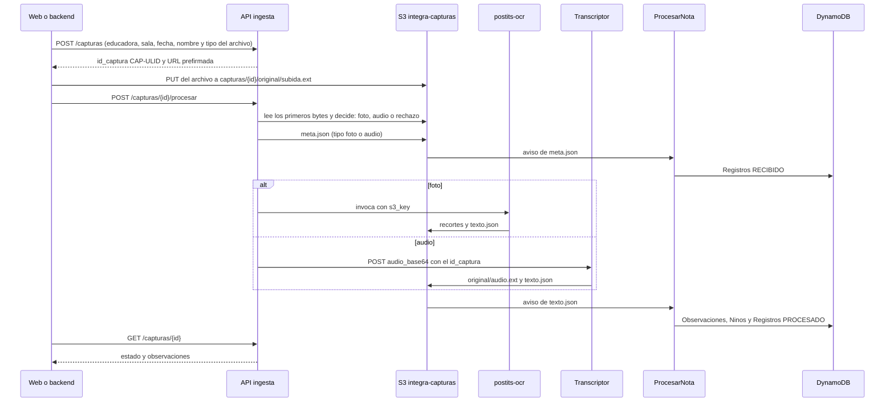

# Plan: entrada única para fotos y audios (meta.json y enrutador)

> Nota: las rutas que empiezan con `.agents/` o `c:\Users\crist\...` son de la máquina donde se desarrolló y probó el módulo; esos archivos no están en el repo.

## El problema

- `ProcesarNota` necesita que `meta.json` exista antes que `texto.json`. Hoy nadie lo escribe, y está pendiente en la lista del equipo. Sin él, la foto solo funciona si `postits-ocr` recibe la educadora y la sala, y el audio espera unos minutos y después queda en `ERROR`.
- Hay dos herramientas y cada una se llama distinto:
  - `postits-ocr` es una Lambda que lee la foto desde S3.
  - El transcriptor es una API con `x-api-key` que recibe el audio en base64, hasta 4 MiB.
- La web no debería tener que decidir cuál de las dos usar.

## La solución: Lambda `ingesta` con una API (stack nuevo `integra-ingesta`)

1. **`POST /capturas`:** valida la educadora y la sala contra DynamoDB, genera el `CAP-<ULID>` y devuelve una URL prefirmada para subir el archivo. No escribe nada en las tablas.
2. **Subida:** la web sube el archivo con `PUT` a esa URL.
3. **`POST /capturas/{id}/procesar`:**
   - Decide el tipo por los bytes del archivo:
     - JPEG o PNG: foto.
     - webm, ogg, mp4/m4a, mp3, wav, flac o amr: audio.
     - HEIC u otro formato: responde 415 y no escribe nada.
   - Escribe `meta.json` con los 4 campos que piden el equipo y `postits-ocr`: `id_educadora`, `sala_grupo`, `fecha_observacion` y `tipo`.
   - Llama a la herramienta que corresponde:
     - foto: `postits-ocr`, en forma síncrona (unos 4 s);
     - audio: el transcriptor, que responde 202 y termina en 15 a 30 s.
4. **`GET /capturas/{id}`:** devuelve el estado de `Registros` y las observaciones de la captura, para la pantalla de revisión.

## Qué tablas se actualizan

Las actualiza todas `ProcesarNota`, igual para foto y audio. La ingesta solo lee DynamoDB.

| Tabla | Cuándo | Qué |
|---|---|---|
| `Registros` | al aparecer `meta.json` y después `texto.json` | `RECIBIDO`, luego `PROCESADO` o `ERROR` |
| `Observaciones` | con `texto.json` | una fila por niño, con nivel, `archivo_s3` y estado `SUGERIDO` |
| `Ninos` | con `texto.json` | `ultima_obs_fecha` y `ultimo_nivel` |

## Decisiones

- **Autenticación:** la API usa REST con `x-api-key`, igual que el transcriptor. Se llama solo desde el backend. El autorizador de Cognito queda pendiente.
- **Clave del transcriptor:** la ingesta la lee en tiempo de ejecución, así que no queda guardada en código ni en variables de entorno.
- **Código:** va en `ingesta/` del repo, con un `template.yaml` de SAM, en la rama `feature/postits-ocr`. Ahora se despliega con boto3, porque CloudFormation aplica la transformación de SAM.
- **Recursos del equipo:** no cambia nada del bucket, del stack ni del transcriptor del equipo.

## Pruebas

1. **Ensayo en seco** de `/procesar`: detecta el tipo y no escribe nada.
2. **Una foto real.**
3. **Un audio real:** una nota corta grabada con la voz de Windows.

Cada prueba real escribe en las tablas del equipo.

## Riesgos

- **Audio:** máximo 4 MiB.
- **Tiempo:** API Gateway corta a los 29 s.
- **Credenciales:** las del evento son temporales.
- **Seguridad:** la clave de API no autentica usuarios.
